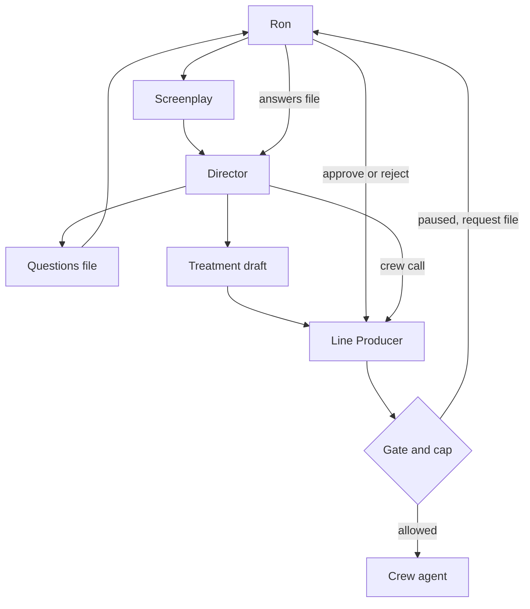
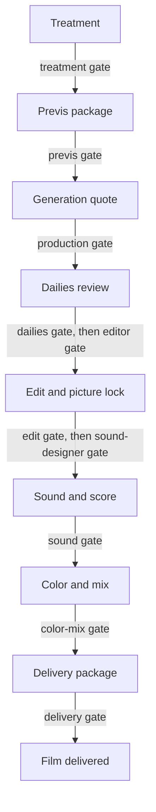

# Architecture

## What the system does

Movie Swarm takes a screenplay and works toward a finished short video. A treatment is the director's plan: intent, look, characters, scene beats, and a proposed budget split. Crew agents then do the jobs of a film crew. A handoff is the JSON file one step gives the next. A schema is the checklist that file must match. If a required field is missing, the handoff stops and the message names the file and the field.

Ron is the executive producer. He reviews at the gates. A gate is an on/off switch for one stage. While the switch is on, that stage waits for Ron. The Line Producer records his yes or no. The Director has the creative calls, and cannot approve itself.

Film facts stay in the production folder. The studio code, the agent instructions, the schemas, and the defaults do not name a film's props, years, or look. The Prop Master and the Script Supervisor read whatever hero props and locked attributes a production defines. The Cinematographer builds a camera package from that production's look file, or from the treatment when no lenses were named. Harbor Night, a tiny fixture under `tests/fixtures/`, uses a scarf and a documentary look. The same code runs it. This rule is D30.

## Where it runs

The crew is Python in this repo. You run a command on your machine. It reads and writes files in the production folder.

The Director and the Line Producer will be fronted by Grok Bot agents. Those bots live outside this repo. They show Ron the gates and the Director's questions in chat. The chat does not type into a waiting terminal. The bot reads and writes the same files these commands use, so a run can stop and start again.

Generation runs on provider servers, not on the laptop that holds the repo. Video, stills, and audio can run at the same time once a later phase turns that on. A provider call is sent only when `--live` is passed, the generation gate is approved, the estimate fits the stage line and the film cap, and the provider key is in the environment. Offline is the default. A dry run is a practice pass: the call is checked, and no generation money is spent. A cost estimate only prices the work. A generation plan is that quote in sentences, for any production that has boards or a shot list. The generation gate is a separate switch. A plan does not need it. A paid call does. The test shot command sends at most one picture call. It was not run live.

## Repository

| Folder | What it holds |
|---|---|
| `agents/00-director/` | The Director's notes and command. |
| `agents/01-line-producer/` | The Line Producer's notes and command. This folder used to be the executive producer agent. Ron is the executive producer now. |
| `agents/02-screenwriter/` through `03-art-director/` | Written instructions. No program yet. |
| `agents/04-cinematographer/` | Camera package and storyboard. The program is in `movie_swarm/`. |
| `agents/05-production/` through `09-fix-loop/` | Coded crew: video, sound, edit, QA, and the fix loop. |
| `agents/10-script-supervisor/`, `11-prop-master/`, `12-stunt-coordinator/` | Phase 2 roles. The programs are in `movie_swarm/`. |
| `movie_swarm/` | Shared code: checklists, the run record, gates, money, the Director, the Line Producer, the phase 2 package, the generation quote, the dailies review, the edit, sound and score, color and mix, delivery, the offline studio run, and the live provider gate. |
| `config/` | Gates, the $500 cap, model names, and the asset root. |
| `schemas/` | The checklists. |
| `productions/the-last-marker/` | The test film. |
| `scripts/` | Commands you run from the repo root. |
| `tests/` | The shared checks. |
| `docs/` | Supporting notes, including the treatment guide. The living docs are the root files named in [CONTRIBUTING.md](CONTRIBUTING.md). |

## Main concepts and data model

**Handoff files.** Agents pass work as JSON. `movie_swarm/handoff.py` checks a file before it is accepted. A bad file is not saved.

**Schemas.** One checklist per kind of file, in `schemas/`. The treatment checklist is `treatment.schema.json`. Questions use `director-questions.schema.json`.

**Run state.** One production run keeps `runs/<run-id>/run-state.json`. It records the stage, whether the run is waiting, the files it produced, and the dollars spent against the cap that was copied when the run opened. That file is the Phase 0 record.

**Line Producer record.** `runs/<run-id>/line-producer.json` sits beside the run state. It holds the ledger (each spend), the stage split, the credits, the schedule, and Ron's decisions. The running total in the run state is updated only when a spend is actually booked.

**Gates.** `config/gates.json` has one switch per stage. `true` means Ron reviews it. A stage with no switch is an error, so a typo cannot skip a review.

**Budget cap.** The film cap is $500 in `config/gates.json`. Landing on $500 is allowed. Going over pauses the spend and writes an approval request. Retakes use the same cap. After Ron approves the treatment, each stage also has its own ceiling. A retake spends from that stage's ceiling and from the film cap.

**Model routing.** `config/model-routing.json` names the model for each role. The Line Producer and the question list use Claude Haiku 5.5. The Director's draft uses Claude Sonnet 5.5. The final treatment pass uses Claude Opus 5.5. The older video program still calls Seedance 2.0. The generation pipeline reads the production role's preview and final purposes, which name Gemini Omni 1.2 Flash. The dailies role names that same picture model, because a later build may watch the clip with it. This build does not call it. The editor assembles with ffmpeg. A notes purpose names Claude Haiku 5.5 and is not called unless `--live` is passed, and even then the rate card has no text price, so the call is refused until Ron approves a one-call price. Sound spotting and the Composer use Claude Haiku 5.5 for notes. Dialogue, effects, and score name ElevenLabs. Seedance and Kling stay alternates. A routing override can name one for a shot. The quote prices only models listed in `config/generation-rates.json`. A live picture call also needs an endpoint on that row. Seedance 2.0 and Seedance 2.0 fast have fal addresses copied from this routing file. Gemini Omni and Kling do not, so a live call for them is refused. The Colorist uses Claude Haiku 5.5 for the grade note. ffmpeg applies the grade. The Mixer renders with ffmpeg. The Post Supervisor uses Claude Haiku 5.5 for a packaging note. ffmpeg renders the delivery files. QC is local. It does not call the QA program's model. Audio, color, and delivery still have no published price in the rate card.

**Generation gate.** `config/gates.json` has a `generation` switch. It starts on. Opening it is Ron's recorded yes on a run. A plan does not ask. A generate call does, after the treatment, the stage, and the previs gate are already open. Opening the gate is not enough. The call also needs `--live`, the provider key, and an estimate that fits the stage line. Without `--live`, the client does not leave the machine.

**Dailies gate.** `config/gates.json` has a `dailies` switch. It starts on. The review can be written while the switch is closed, because that report is what Ron reads. The editor does not run until Ron approves it, even if the editor's own gate is already open.

**Edit gate.** `config/gates.json` has an `edit` switch. It starts on. This is picture lock. The editor can write the cut while the switch is closed, because that cut is what Ron reads. Sound does not run until Ron approves it.

**Sound gate.** `config/gates.json` has a `sound` switch. It starts on. The cue sheet can be written while the switch is closed, because that sheet is what Ron reads. Color and mix do not run until Ron approves it, and they also wait for the edit gate.

**Color-mix gate.** `config/gates.json` has a `color-mix` switch. It starts on. The grade plan and the mix plan can be written while the switch is closed, because those plans are what Ron reads. Final delivery does not run until Ron approves it.

**Delivery gate.** `config/gates.json` has a `delivery` switch. It starts on. The package can be written while the switch is closed, because that package is what Ron reads. Approving it stamps the delivery manifest and marks the film delivered.

**Asset root.** Finished video can live on an external drive. Set `MOVIE_SWARM_ASSET_ROOT`, or set `asset_root` in `config/assets.json`. Until one of those is set, files stay in the production folder. Nothing is moved by itself.

## Decisions

The choices already made are in [DECISIONS.md](DECISIONS.md). Short form:

- Ron is the executive producer. The old agent slot is the Line Producer (D1).
- The Director may call crew, inside the money Ron approved (D2, D5).
- Every stage starts gated (D3).
- The output is a finished video (D4).
- The cap is $500, retakes included (D5).
- Models are chosen to keep cost down (D6).
- The Last Marker is the test film through every phase (D7), set in 1967, with a 1965 Triumph (D10) and a Leone look (D8).
- Finished media is meant for Ron's external drive (D9). The delivery package is written there when the asset root is set. The path is still a setting. It is not hard-coded.
- Hero props get locked specs (D11). This film's sidedness is in its production files (D27). The checker reads those files. It does not hard-code them (D30).
- A Stunt and Action Coordinator breaks the treatment's beats into shots (D12).
- The Director reaches a treatment by asking Ron questions (D13). The Last Marker treatment gate is approved and the $500 split is locked (D29).
- Docs and code land in the same pull request (D14).
- Film facts stay in the production folder (D30). The pilot sound prompts moved there (D45, pending Ron's approval at merge).
- The studio is built before the film (D41). Harbor Night proves a new picture tool. The Last Marker waits for the last phase.
- Dailies review circles, retakes, or rejects each take before the edit (D47 through D51, pending Ron's approval at merge). The editor waits on that gate.
- The edit cuts circled takes into an edit decision list and a picture-lock candidate (D52 through D57, pending Ron's approval at merge). Sound waits on the edit gate.
- Sound and score spot a cue sheet onto the locked cut (D58 through D63, pending Ron's approval at merge). Color and mix wait on the sound gate.
- Color and mix grade the locked picture and mix the stems (D64 through D70, pending Ron's approval at merge). Final delivery waits on the color-mix gate.
- Final delivery packages the locked cut from the production's delivery spec (D71 through D79, pending Ron's approval at merge). The delivery gate marks the film delivered.
- A live provider call waits on `--live`, the generation gate, the stage line, and the key (D80 through D86, pending Ron's approval at merge). Offline stays the default. Audio, color, and delivery stay unpriced.

## Interfaces

Two commands. Both take a production folder and a run id. Neither waits for you to type at a prompt.

| Command | What Ron uses it for |
|---|---|
| `scripts/line-producer.py` | Start a run, read status, record a spend, approve or reject a gate, decide a spend request, add a credit, or prepare one test shot. |
| `scripts/director.py` | Draft a treatment, apply an answers file, call a crew agent. |

Question file: `productions/<id>/treatment/questions.json`. Each question has an `id`, a `topic`, the question, and `answer`. Ron fills `answer`, or sends a separate file shaped as `{ "answers": [ { "id", "answer" } ] }`.

Gate file, if you prefer a file to flags:

```json
{ "stage": "treatment", "decision": "approved", "by": "ron", "note": "Lock it." }
```

A spend that would break a ceiling writes `runs/<run-id>/requests/req-001.json`. Approve or reject it with `decide`. Approving a real spend books the money, even if it is past the cap. That overage stays visible in the status. Approving a dry-run hold does not book money. It allows that one checked call.

Crew the Director can call: `prop-master`, `script-supervisor`, `cinematographer`, `stunt-coordinator`, `production`, `sound-designer`, `composer`, `editor`, `qa`, `fix-loop`, `dailies`, `colorist`, `mixer`, `post-supervisor`. The Director command `studio`, and `scripts/studio.py`, walk those calls from the treatment through delivery and stop at each closed gate. They do not approve a gate. A test may pass `auto_approve=True` to `run_studio`. That records the approver as `test-auto-approve`. The command line does not pass it. The generation gate stays closed either way.

Phase 2 commands are `lock`, `check`, `package`, `boards`, and `breakdown`. They read the approved treatment. They write files. They do not require the previs gate to be open already, because those files are what Ron reviews. Ron approved that gate for The Last Marker on 2026-11-10. The estimate is checked against an existing ceiling in the locked split and is not charged.

Picture commands are `estimate`, `dry-run`, `plan`, and `generate`. Estimate and dry-run are the older local price check. A plan is the generation quote. It waits until Ron has approved the treatment, the previs gate, and that stage, and it does not spend. Generate is the paid path. It also waits for the generation gate. It calls fal only when the Director command also passes `--live`. The Line Producer command `test-shot` is the one-shot version of that call. The dailies command is `review`. It reads a takes manifest and writes the report. It waits for the treatment and the previs gate. It does not wait for its own gate, because the report is the review. The editor command `assemble` writes the cut. It waits for the treatment, the previs gate, the editor's own gate, and the dailies gate. It does not wait for the edit gate, because the cut is the review. The older editor dry-run is still only routed. QA and the fix loop are routed and named. Their commands are not run here. Sound waits for the edit gate, which is picture lock. The sound designer and the composer command `spot` writes the cue sheet. It waits for the treatment, the previs gate, the sound designer's gate, and the edit gate. It does not wait for the sound gate, because the sheet is the review. `generate` is the paid path. It also waits for the generation gate. The older sound dry-run is still the local prompt check. The Composer's estimate is checked against the sound-designer allocation, which is the Sound line. The colorist command `grade` and the mixer command `mix` write the finishing plans. They wait for the treatment, the previs gate, the edit gate, and the sound gate. They do not wait for the color-mix gate, because the plans are the review. The Post Supervisor command `deliver` writes the package. It waits for the color-mix gate. It does not wait for the delivery gate, because the package is the review. Approving that gate stamps the manifest.

## Line Producer

Inputs: the gate file, the run state, and Ron's decision (flags or a JSON file).

Outputs: an updated run state, `line-producer.json`, a plain-language status, and an approval-request file when something must wait.

Hands off to: Ron, by the status and the request file. The Director reads the same run when it wants to call crew. The Line Producer does not write the story.

## Director

Inputs: a screenplay (Markdown, Fountain, PDF, or Word), an optional partial treatment, the production brief, and the Screenwriter and Art Director skill files as context.

Outputs: `treatment/treatment.json` (must match the checklist), `treatment/treatment.md` (the same plan in sentences), and `treatment/questions.json`. Status stays `draft`.

Hands off to: Ron, for answers and for the treatment gate. Hands off to the Line Producer before any crew call. Does not hand an approval to itself.

## Prop Master

Inputs: `props/prop-definitions.json` when the production has one, otherwise the hero props on the approved treatment and the brief.

Outputs: `props/hero-props.json`, checked against `hero-props.schema.json`, and a short Markdown note.

Hands off to: the Script Supervisor and the Cinematographer, through that locked file. Does not invent a prop or a side.

## Script Supervisor

Inputs: the locked hero props, the treatment scenes, `storyboard/shot-list.json` when it exists, and `shot-lists/shot-list.json` when it exists.

Outputs: `continuity/continuity-check.json`. A finding is a contradiction (a forbidden phrase) or a missing lock (a shot shows the prop and never states a required phrase). The phrases come from the prop file.

Hands off to: Ron, at the previs gate. This is not the QA report. QA reads a cut, later.

## Cinematographer

Inputs: `look/look.json` when the production has one, otherwise the treatment's camera and color notes and the brief.

Outputs: `camera/camera-package.json` (lenses, framing, lighting), `storyboard/storyboard.json` (one beat per shot, plus an animatic), and `storyboard/shot-list.json`. The look is written once. A shot lists only its own frame, move, and light. A locked prop is named only when that beat puts it in frame. If the brief has a featured product, the storyboard lists those shots. Each reason is one sentence from the brief, not a clipped copy of the beat. Extra beats, such as a new danger shot, are written into the screenplay and the treatment. The generator does not invent them. Image generation runs only when a caller passes an image client. The default path stores the prompt and does not make a picture.

Hands off to: production, through the shot list, after Ron approves the previs gate.

## Stunt and Action Coordinator

Inputs: `action_and_stunt_beats` on the approved treatment.

Outputs: `stunts/action-breakdown.json`. Each beat becomes shots. A beat that is not physically possible is marked. The safety line is the same for every film: one movement per shot, no real impact, no real fall, no real fire.

Hands off to: the Cinematographer and production, through that breakdown. Does not add a beat the treatment does not name.

## Production

Inputs: a shot list JSON.

Outputs: clip files, clip metadata, and a cost report, when a real run is allowed. This phase writes a generation plan, or runs the older local price estimate, or a dry run that builds the request and does not call the video service. The plan reads the storyboard when one exists, otherwise a shot list. For each shot it names the generator, the clip length, the two takes it allows (one preview and one final), and the price. It adds the retake reserve and sets every line against the locked split. Rates come from `config/generation-rates.json`, with the source and the date. A line that is not a published price is marked as an assumption. Stills and sound are not priced on the picture quote, because that card has no rate for them. The sound plan, later, reads the same card and marks an audio rate unknown instead of storing a zero.

Before a prompt is sent, a locked prop that is in the shot must have its required phrase in the prompt. A forbidden phrase blocks the call. The phrases come from the production's prop file.

After a client returns, `review_dailies` records the phrases it would check and marks the shot `not-reviewed`. It does not open the file and it does not call a model. The review that circles a take is a separate dailies call.

Hands off to: Ron, through the plan, before any money moves. Hands off to the Dailies Reviewer, through the takes manifest, once clips exist. The default client does not leave the machine. A `--live` call can, after the estimate is reserved on the ledger. The file is written under the asset root when that setting is set.

## Dailies Reviewer

Inputs: the production folder, `takes/takes-manifest.json` (or a path passed to the call), the shot list, `props/prop-definitions.json` or the locked hero props, and `look/look.json` when the production has one. Each take names a shot id and a clip or frame file.

Outputs: `dailies/dailies-report.json`, checked against `dailies-report.schema.json`, and `dailies/dailies-report.md`, a table of each shot, the best take, the verdict, and the reasons. A retake row carries a prompt fix for the next generation call and a preview estimate.

The verdict is one of three words. Circle means the take can be cut. Retake means generate it again. Reject means the file is missing or empty, so there is nothing to watch.

Four checks:

- Continuity uses the same locked phrases as the Prop Master and the Script Supervisor. The shot list says which props are in frame. The description of the picture must include a required phrase and must not include a forbidden phrase. The description comes from a vision client. Tests pass a fake client. With no client, a text file beside the frame is the description. If neither is there, the description is empty and a required phrase cannot pass. No model is called.
- Shot match compares that description with the shot list: the framing word, the subject, and, for a clip, the duration. Duration matches when it is within half a second or 20 percent of the shot length, whichever is larger, and only when ffprobe could read it.
- Look match compares the description with phrases in `look/look.json`. A film with no look file skips this check.
- Technical checks need no paid call. The file must exist and must not be empty. When ffprobe is installed it reads duration, size, and frame rate. When ffmpeg is installed, a black stretch of half a second or more is a retake, and a frozen clip is a retake only if the shot list asked for camera movement. A static hold is not a freeze. If those tools are missing, or cannot read the file, that part is skipped and the file check still stands.

The retake estimate is one preview per shot that needs another generation, priced from `config/generation-rates.json`. It is compared with the locked fix-loop line, minus anything already spent on that line. Over the line, the list is kept and marked not cleared to spend. Nothing is charged either way. The prompt fix is text for the Phase 3 generate step. This phase does not call it.

Hands off to: Ron, at the dailies gate. Hands off to the editor only after that approval. Hands off to production, through the prompt fixes, when a retake is cleared.

## Sound Designer and Composer

Inputs: the picture-lock cut, `audio/sound-prompts.json` when the production has one, `audio/score-brief.json` when the production has one, and the locked prop file. A prop can carry a sound prompt. The call waits for the edit gate, so the cut is the one Ron has locked.

Outputs: `sound/cue-sheet.json`, checked against `cue-sheet.schema.json`, and `sound/cue-sheet.md`. Each cue names a type (dialogue, sfx, foley, ambience, or music), a start and end on the cut, the shot ids, a prompt, and a source of generated, library, or silence. JSON is the source of truth. Music cues take tempo, instrumentation, motifs, and silence from the score brief. A production with no brief gets no invented score. A silence entry wins over a motif on the same shot.

Every placed cue has to lie inside the cut. A cue that names a shot the cut does not have is not placed, and the sheet records a missing-shot flag. An effect or a foley cue has to land within half a second of its shot, unless the production sets `sync_tolerance_seconds`. A prop sound that plays in a shot which does not show that prop is a continuity flag. The phrases and the prop ids come from the production.

The quote uses `config/generation-rates.json`, the same card as the picture plan. A model with no row is marked unknown. That unknown is not stored as zero. The total is set against the locked sound-designer allocation, the Sound line. Library and silence are not charged. A `generate` call waits on the generation gate. A closed gate does not call the client. Without `--live`, the client does not open a network connection. With `--live`, ElevenLabs is called only when the price is on the card or Ron has approved a one-call override. The card has no audio price, so the override is the only way through.

When ffmpeg is installed, the stage renders `sound/stems/dialogue.wav`, `sound/stems/effects.wav`, `sound/stems/music.wav`, and `sound/stems/mix-preview.wav`. The tones are placeholders. When ffmpeg is missing, the stems are skipped and the cue sheet is still written. Spotting is computed in code. The admin model is Claude Haiku 5.5. This build does not call it. Nothing is spent.

The older sound program can still dry-run a prompt library into an audio manifest. It does not call a provider. The Director's `spot` command is the cue sheet.

`sound_approved` stays false. Ron's approval of the sound gate is the approval.

Hands off to: Ron, at the sound gate. Hands off to the Colorist and the Re-recording Mixer only after that approval, and only after picture lock.

## Editor

Inputs: the dailies report, the storyboard order (or a shot list when there is no board), the scene structure, the production brief's target runtime, and `edit/editing-style.json` when the production has one. The call waits for the dailies gate, so the circled takes are the ones Ron has approved.

Outputs: `edit/rough-cut.json`, checked against `edit-decision-list.schema.json`, `edit/rough-cut.md`, and `edit/assembly.edl`, a CMX3600 reading copy. JSON is the source of truth. Each event names the shot, the circled take, source in and out, duration, and the transition. The default is a cut. A dissolve or a fade comes from the storyboard frame or the editing-style file. Scene markers come from the scene manifest, then the treatment headings.

The order is the storyboard animatic. The editor does not invent a shot. It trims a long cut toward the target runtime and reports the over or the under. It does not pad a short cut. The tolerance is one second or ten percent of the target, whichever is larger, unless the editing-style file sets `runtime_tolerance_seconds`. A shot with no circled take is a missing-coverage blocker. A retake is routed to generation. Anything else goes back to dailies.

Adjacent shots in the cut are checked with the same locked phrases the Prop Master and the Script Supervisor use. The text is the shot description plus the dailies notes. A locked prop that changes across the cut is flagged. The shots stay in the cut. The flag blocks picture lock.

When ffmpeg is installed, the editor renders `edit/rough-cut.mp4` at 160 by 90. When it is not, the preview is skipped and the edit decision list is still written. The assembly tool is ffmpeg. A notes model is named and not called. Nothing is spent.

A clean cut also writes `edit/picture-lock.json`. `picture_lock` stays false. Ron's approval of the edit gate is the lock.

Hands off to: Ron, at the edit gate. Hands off to the Sound Designer and the Composer only after that approval. Hands off to dailies or generation, through the blockers, when a shot has no circled take.

## Colorist

Inputs: the picture-lock cut, `look/look.json`, and `look/grade.json` when the production has one. The call waits for the edit gate and the sound gate.

Outputs: `color/grade-plan.json`, checked against `grade-plan.schema.json`, and `color/grade-plan.md`. The base grade is stated once. A scene adjustment is stated once and applied to every shot in that scene. A shot adjustment appears only when the production names that shot. JSON is the source of truth.

The numbers come from the production. A look with no numeric grade keeps a neutral base and records the look's name, summary, palette, and lighting. The engine does not invent a time of day, a contrast, or a warmth.

Adjacent shots in the same scene are compared. When ffmpeg is installed, signalstats reads average brightness and average color. A difference past the tolerance is a flag. The tolerance comes from the grade file when it sets one. Otherwise it is 0.12 on a 0 to 1 scale. Shots in different scenes are not compared. When ffmpeg is missing, the check is skipped and the plan is still written.

When ffmpeg is installed, each shot is graded with eq and colorbalance and joined into `color/graded-preview.mp4` at 160 by 90. A curves string or a `.cube` LUT is applied when the production supplies one. A LUT is a color lookup table. When ffmpeg is missing, the preview is skipped.

The grade is checked against the editor allocation. No new budget line is added. No color rate is on the rate card, so the estimate is unknown and is not stored as zero. The admin model is Claude Haiku 5.5. This build does not call it. Nothing is spent.

`color_mix_approved` stays false. Ron's approval of the color-mix gate is the approval.

Hands off to: Ron, at the color-mix gate. Hands off to the Post Supervisor only after that approval.

## Re-recording Mixer

Inputs: the picture-lock cut, `sound/cue-sheet.json`, the stems under `sound/stems/` when they exist, and `audio/mix-targets.json` when the production has one. The call waits for the edit gate and the sound gate.

Outputs: `color/mix-plan.json`, checked against `mix-plan.schema.json`, and `color/mix-plan.md`. Each stem has a level. Dialogue is the priority. Music and effects duck under each dialogue cue. A scene change gets a fade. JSON is the source of truth.

The studio defaults are dialogue at 0 dB, effects at -8 dB, music at -12 dB, an extra -8 dB under dialogue, and a 0.5 second fade. The production file can replace any of them. They are not a film's facts.

Loudness uses EBU R128 when the production does not set a target. That standard is -23.0 LUFS integrated, true peak no higher than -1.0 dBTP, with a flag past 0.5 LU. The citation is on the plan. When ffmpeg is installed, the mix is `color/mix.wav` and the meter is ebur128, with loudnorm as the fallback. A miss is a flag. When ffmpeg is missing, the mix and the measurement are skipped and the plan is still written.

The mix is checked against the sound-designer allocation, the Sound line. No new budget line is added. No mix rate is on the rate card, so the estimate is unknown. ffmpeg is the render tool. A notes model is Claude Haiku 5.5 and is not called. Nothing is spent.

When both the graded preview and the mix are on disk, ffmpeg marries them into `color/married-preview.mp4`.

Hands off to: Ron, at the color-mix gate, together with the grade. Hands off to the Post Supervisor only after that approval.

## Post Supervisor

Inputs: the picture-lock cut, `delivery/delivery-spec.json` when the production has one, `sound/cue-sheet.json` for dialogue captions, and `color/mix.wav` when the mix was rendered. The call waits for the color-mix gate.

Outputs: `delivery/delivery-plan.json`, checked against `delivery-plan.schema.json`, and `delivery/delivery-plan.md`. Caption sidecars `captions.srt` and `captions.vtt`, timed from the dialogue cues. When ffmpeg is installed, a master file, the variants the spec asks for, and a poster frame. A 9:16 or 1:1 variant is a center crop, with safe-area guidance cited from EBU R95. The master is high-quality H.264, or ProRes 422 HQ when the spec asks and ffmpeg has a ProRes encoder. When ffmpeg is missing, the picture files are skipped and the plan and the captions are still written.

QC writes `delivery/qc-report.json`, checked against `qc-report.schema.json`, and `delivery/qc-report.md`. Each row is pass, fail, or skipped. The checks are duration, resolution, frame rate, loudness, black stretches, frozen stretches, and caption timing. The tools are the same local ffprobe, blackdetect, and freezedetect checks the dailies reviewer uses. The QA program's Claude model is not called. A skipped row means the file or the tool was missing. A fail makes the verdict fail. The package is still saved.

The manifest is `delivery/delivery-manifest.json`, checked against `delivery-manifest.schema.json`, plus `delivery/delivery-manifest.md`. It lists each file, a SHA-256 checksum when the file is on disk, the film spend against the cap, the locked stage split and what each line has spent, and every gate record: who, when, and the note. A gate with no record is listed as pending. No delivery rate is on the rate card, so that price is unknown and is not stored as zero. Nothing is charged. The Post Supervisor is checked against the editor allocation. No new budget line is added. The admin model is Claude Haiku 5.5. This build does not call it.

The package folder is `delivery/` inside the production unless `MOVIE_SWARM_ASSET_ROOT` or `asset_root` in `config/assets.json` is set. The resolved path is recorded on the manifest. The code does not name a drive. `delivery/location.json` in the production folder points at the package.

`delivery_approved` stays false until the Line Producer records the delivery gate. That approval stamps the manifest and sets the run to completed.

Hands off to: Ron, at the delivery gate. That approval is the film delivered.

## Studio run

`scripts/studio.py`, and the Director command `studio`, walk one production from the treatment through delivery. The default stops at the first gate Ron has not approved. Run it again after that approval. The order of stops is treatment, previs, production, dailies, editor, edit, sound-designer, sound, color-mix, and delivery. The generation gate is not approved by this walk. A quote is written. A paid generate call is not.

When the production has no takes manifest, the walk writes synthetic placeholder clips, or stills when ffmpeg is missing, and a note in `takes/placeholder.txt`. A sidecar text file is the picture description, so dailies can circle a take without a vision model. A production that already has a takes manifest keeps those files.

`run_studio(..., auto_approve=True)` is a test harness. It records each approval as `test-auto-approve`. It is not the default. The command line does not set it. It does not approve the generation gate.

Hands off to: Ron, at whichever gate is still closed. After the delivery gate, the manifest says the film is delivered.

## Live providers

`movie_swarm/providers.py` is the gate in front of Anthropic, fal, and ElevenLabs. The HTTP helper retries a connection error and a 429 or 5xx, with a short backoff. A timeout on a request that might already have been accepted is not sent again. The request is hashed. The hash does not include the key. A second run of the same hash reads the saved file and writes a dry-run ledger line. It does not charge again.

Before the call, the Line Producer reserves the estimate. After the call, that same ledger row keeps the estimate and, when the provider reports a dollar amount, the actual. The booked amount becomes the actual. When the provider does not report one, the booked amount stays the estimate. An unknown estimate is refused. `--price-override` writes an approval request and waits. Approving it records the amount. It does not invent a price for the rate card.

A failure sets the run back to waiting. The stage does not move forward. Keys are read from `ANTHROPIC_API_KEY`, `FAL_KEY`, and `ELEVENLABS_API_KEY`. They are stripped from errors, the ledger, and the cache. Downloaded bytes go through `resolve_asset`, so they follow `MOVIE_SWARM_ASSET_ROOT` or `config/assets.json`. `asset_root` stays null.

## QA

Inputs: a cut, plus the style bible and the shot list.

Outputs: a continuity report and a short summary. The review calls a model and is not run by the Director in this phase. Frame extraction needs the cut on disk.

Hands off to: the fix loop, through the report.

## Fix Loop

Inputs: the latest QA report and the shot list.

Outputs: a fix plan with changed prompts. Showing or writing that plan is not run by the Director in this phase, so a dispatch cannot overwrite the pilot's fix notes.

Hands off to: production, the editor, and QA, for another pass. The cap still applies. A retake is not free.

## Flow



The stage flow, from the treatment to a delivered file. Each arrow waits for Ron's approval of the gate named on it. The generation gate stays closed. A quote can be written. A paid call cannot.



## Not in this phase

- The Last Marker as a generated film. The approved previs stays. The first film phase is what makes it. That phase needs Ron's generation-gate approval, any provider keys he wants used, a delivery spec in that film's folder, and the drive path if the package should leave the repo.
- A paid vision model. Dailies names Gemini Omni 1.2 Flash and does not call it. The description is a fake client or a text file beside the frame. Delivery QC does not call one either.
- A test audience. The Composer spots from the production's score brief and does not call a music service. The Re-recording Mixer builds the mix plan in code and does not call one either.
- The older QA program's Claude review of a finished cut. Delivery QC is the local technical pass. It does not call that model. The fix loop is not replaced.
- A live run of the test shot. The command exists. It was not executed against a provider. Storyboard images stay behind an image client. The default client is none. The studio walk writes synthetic placeholders when a production has no takes, and it never passes `--live`.
- A published price for audio, color, or delivery. None is in the repo, so those calls stay unknown.
- A fal address for Gemini Omni 1.2 Flash or Kling. The rate card has their picture prices and no endpoint, so a live call for them is refused.
- Copying every working file to an external drive. The delivery package is written to the asset root when that setting is set. Earlier stages stay in the production folder.
- Switching the older video program off Seedance. The new pipeline quotes Gemini Omni 1.2 Flash and does not call it.
