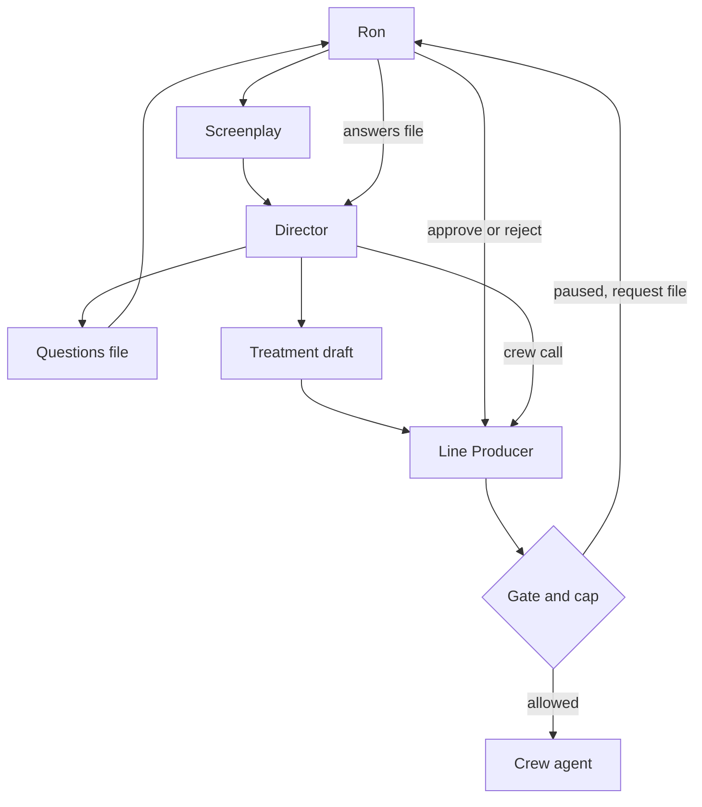
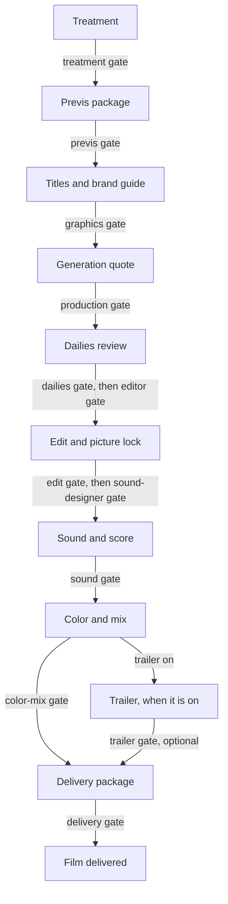

# Architecture

## What the system does

Movie Swarm takes a screenplay and works toward a finished short video. A treatment is the director's plan: intent, look, characters, scene beats, and a proposed budget split. Crew agents then do the jobs of a film crew. A handoff is the JSON file one step gives the next. A schema is the checklist that file must match. If a required field is missing, the handoff stops and the message names the file and the field.

Ron is the executive producer. He reviews at the gates. A gate is an on/off switch for one stage. While the switch is on, that stage waits for Ron. The Line Producer records his yes or no. The Director has the creative calls, and cannot approve itself.

Film facts stay in the production folder. The studio code, the agent instructions, the schemas, and the defaults do not name a film's props, years, or look. The Prop Master and the Script Supervisor read whatever hero props and locked attributes a production defines. Wardrobe and makeup use the same kind of lock when the production defines them. The Cinematographer builds a camera package from that production's look file, or from the treatment when no lenses were named. Harbor Night, a tiny fixture under `tests/fixtures/`, uses a scarf and a documentary look. The same code runs it. This rule is D30.

## Where it runs

The crew is Python in this repo. You run a command on your machine. It reads and writes files in the production folder.

The Director and the Line Producer will be fronted by Grok Bot agents. Those bots live outside this repo. They show Ron the gates and the Director's questions in chat. The chat does not type into a waiting terminal. The bot reads and writes the same files these commands use, so a run can stop and start again.

Generation runs on provider servers, not on the laptop that holds the repo. Video, stills, and audio can run at the same time once a later phase turns that on. A picture or audio call is sent only when `--live` is passed, the generation gate is approved, the estimate fits the stage line and the film cap, and the provider key is in the environment. A text call uses a writing approval on the run instead of that gate. Offline is the default. `--live` with no writing approval prints a quote and sends nothing. A dry run is a practice pass: the call is checked, and no generation money is spent. A cost estimate only prices the work. A generation plan is that quote in sentences, for any production that has boards or a shot list. The generation gate is a separate switch. A plan does not need it. A paid picture or audio call does. The test shot command sends at most one picture call. It was not run live.

## Repository

| Folder | What it holds |
|---|---|
| `agents/00-director/` | The Director's notes and command. |
| `agents/01-line-producer/` | The Line Producer's notes and command. This folder used to be the executive producer agent. Ron is the executive producer now. |
| `agents/02-screenwriter/` through `03-art-director/` | Written instructions. No program yet. |
| `agents/04-cinematographer/` | Camera package and storyboard. The program is in `movie_swarm/`. |
| `agents/05-production/` through `09-fix-loop/` | Coded crew: video, sound, edit, QA, and the fix loop. |
| `agents/10-script-supervisor/`, `11-prop-master/`, `12-stunt-coordinator/` | Phase 2 roles. The programs are in `movie_swarm/`. |
| `agents/13-assistant-director/` through `18-vfx-supervisor/` | Phase 8.6 roles: schedule, lighting, grip, wardrobe, makeup, and VFX. The programs are in `movie_swarm/`. |
| `agents/19-title-graphic-design/` | Title and Graphic Design. Research, the brand guide, and the graphic specs. The program is in `movie_swarm/`. |
| `agents/20-trailer-editor/` | Trailer Editor. Research, the spoiler guard, the plan, and the cut. The program is in `movie_swarm/`. |
| `movie_swarm/` | Shared code: checklists, the run record, gates, money, the per-film budget, the Director, the Line Producer, the phase 2 package, the generation quote, the dailies review, the edit, sound and score, color and mix, delivery, title and graphic design, the trailer, the offline studio run, and the live provider gate. |
| `tools/budget-calculator/` | One static page for the whole film budget. No build step. |
| `config/` | Gates, the fallback $500 cap, the rate card, model names, and the asset root. |
| `schemas/` | The checklists. |
| `productions/the-last-marker/` | Archived copy of the first film. The working film lives in the films folder, outside this repo. Prior approvals are in `archive/`. Harbor Night, under `tests/fixtures/`, is the in-repo example. |
| `scripts/` | Commands you run from the repo root. |
| `tests/` | The shared checks. |
| `docs/` | Supporting notes, including the treatment guide. The living docs are the root files named in [CONTRIBUTING.md](CONTRIBUTING.md). |

## Main concepts and data model

**Handoff files.** Agents pass work as JSON. `movie_swarm/handoff.py` checks a file before it is accepted. A bad file is not saved.

**Schemas.** One checklist per kind of file, in `schemas/`. The treatment checklist is `treatment.schema.json`. Questions use `director-questions.schema.json`.

**Run state.** One production run keeps `runs/<run-id>/run-state.json`. It records the stage, whether the run is waiting, the files it produced, and the dollars spent against the cap that was copied when the run opened. That file is the Phase 0 record.

**Line Producer record.** `runs/<run-id>/line-producer.json` sits beside the run state. It holds the ledger (each spend), the stage split, the credits, the schedule, and Ron's decisions. The running total in the run state is updated only when a spend is actually booked.

**Gates.** `config/gates.json` has one switch per stage. `true` means Ron reviews it. A stage with no switch is an error, so a typo cannot skip a review.

**Budget.** A film can keep `budget.json` in its production folder. The folder may live outside this repo. The total can be any amount. Line shares are percentages of that total. The default shares are the locked split: Production 54%, Sound 11%, Fix loop 10%, QA 9%, Art 5%, Director 4%, Editor 3%, Cinematographer 2%, Screenwriter 1%, Line Producer 1%. At $500, with the trailer off and no contingency, those percentages are the current dollar ceilings.

When the trailer is on, Marketing and Distribution takes its share. The suggested share is 10%. The other lines scale down so the dollars still equal the budget. Contingency is a percent held back inside the budget. The suggested share is 10%, and it can be 0. Retakes and tier upgrades draw on it after a line is spent. A film with no budget file does not use this math. It keeps the $500 cap in `config/gates.json` and the locked split.

The budget is soft. Landing on the number is allowed. Going past a line, once contingency is used up, or past the film total, pauses the spend and writes an approval request. Ron can approve that request. The spend is recorded, including the overage, and `budget.json` is not edited. Nothing is spent past the budget without that record. Reports say whether the film is under or over, and by how much.

Each stage can name a tier: good, better, or best. The prices live in `config/rate-card.json`. For picture, good is Gemini Omni 1.2 Flash, better is Seedance 2.0 fast at 720p, and best is Seedance 2.0 at 720p. Seedance 2.0 at 1080p is a top option. A price this repo cannot verify is marked unknown. The calculator at `tools/budget-calculator/index.html` is the one screen for the whole film. It imports and exports the same `budget.json` the engine reads.

**Model routing.** `config/model-routing.json` names the model for each role. The Line Producer and the question list use Claude Haiku 5.5. The Director's draft uses Claude Sonnet 5.5. The final treatment pass uses Claude Opus 5.5. The older video program still calls Seedance 2.0. The generation pipeline reads the production role's preview and final purposes, which name Gemini Omni 1.2 Flash. That role also names good, better, and best. Those tiers match the budget rate card. A test shot uses `--model`, then `--tier`, then the film's budget tier, then the routing file. Gemini Omni 1.2 Flash stays the good tier. It has no fal endpoint, so a live call for it is refused and the message lists the wired picture models. The call does not switch models. The generation quote still prices the preview and final purposes. The dailies role names that same picture model, because a later build may watch the clip with it. This build does not call it. The editor assembles with ffmpeg. A notes purpose names Claude Haiku 5.5 and is not called unless `--live` is passed, and even then the rate card has no text price, so the call is refused until Ron approves a one-call price. Sound spotting and the Composer use Claude Haiku 5.5 for notes. Dialogue, effects, and score name ElevenLabs. Seedance and Kling stay alternates. A routing override can name one for a shot. The quote prices only models listed in `config/generation-rates.json`. A live picture call also needs an endpoint on that row. Seedance 2.0 and Seedance 2.0 fast have fal addresses copied from this routing file. Gemini Omni and Kling do not, so a live call for them is refused. The Colorist uses Claude Haiku 5.5 for the grade note. ffmpeg applies the grade. The Mixer renders with ffmpeg. The Post Supervisor uses Claude Haiku 5.5 for a packaging note. ffmpeg renders the delivery files. QC is local. It does not call the QA program's model. Audio, color, and delivery still have no published price in the rate card.

**Generation gate.** `config/gates.json` has a `generation` switch. It starts on. Opening it is Ron's recorded yes on a run. A plan does not ask. A generate call does, after the treatment, the stage, and the previs gate are already open. Opening the gate is not enough. The call also needs `--live`, the provider key, and an estimate that fits the stage line. Without `--live`, the client does not leave the machine.

**Dailies gate.** `config/gates.json` has a `dailies` switch. It starts on. The review can be written while the switch is closed, because that report is what Ron reads. The editor does not run until Ron approves it, even if the editor's own gate is already open.

**Edit gate.** `config/gates.json` has an `edit` switch. It starts on. This is picture lock. The editor can write the cut while the switch is closed, because that cut is what Ron reads. Sound does not run until Ron approves it.

**Sound gate.** `config/gates.json` has a `sound` switch. It starts on. The cue sheet can be written while the switch is closed, because that sheet is what Ron reads. Color and mix do not run until Ron approves it, and they also wait for the edit gate.

**Color-mix gate.** `config/gates.json` has a `color-mix` switch. It starts on. The grade plan and the mix plan can be written while the switch is closed, because those plans are what Ron reads. Final delivery does not run until Ron approves it.

**Delivery gate.** `config/gates.json` has a `delivery` switch. It starts on. The package can be written while the switch is closed, because that package is what Ron reads. Approving it stamps the delivery manifest and marks the film delivered.

**Asset root.** Finished video can live on an external drive. Set `MOVIE_SWARM_ASSET_ROOT`, or set `asset_root` in `config/assets.json`. Until one of those is set, files stay in the production folder, wherever that folder lives. Nothing is moved by itself.

**Films root.** The working film folder lives outside this repo (D129). Set `MOVIE_SWARM_FILMS_ROOT`, or set `films_root` in `config/assets.json`. When that is unset, a production name uses the asset root. `--production the-last-marker` means `<films root>/the-last-marker`. An absolute path is used as given. Doctor names the source and whether the folder exists. It does not print the path. No path is written in this repo.

## Decisions

The choices already made are in [DECISIONS.md](DECISIONS.md). Short form:

- Ron is the executive producer. The old agent slot is the Line Producer (D1).
- The Director may call crew, inside the money Ron approved (D2, D5).
- Every stage starts gated (D3).
- The output is a finished video (D4).
- The cap is $500, retakes included (D5).
- Models are chosen to keep cost down (D6).
- The Last Marker is the test film through every phase (D7), set in 1967, with a 1965 Triumph (D10) and a Leone look (D8).
- Finished media is meant for Ron's external drive (D9). The delivery package is written there when the asset root is set. The path is still a setting. It is not hard-coded.
- Hero props get locked specs (D11). This film's sidedness is in its production files (D27). The checker reads those files. It does not hard-code them (D30).
- A Stunt and Action Coordinator breaks the treatment's beats into shots (D12).
- The Director reaches a treatment by asking Ron questions (D13). The Last Marker treatment gate is approved and the $500 split is locked (D29).
- Docs and code land in the same pull request (D14).
- Film facts stay in the production folder (D30). The pilot sound prompts moved there (D45, pending Ron's approval at merge).
- The studio is built before the film (D41). Harbor Night proves a new picture tool. The Last Marker waits for the last phase.
- Dailies review circles, retakes, or rejects each take before the edit (D47 through D51, pending Ron's approval at merge). The editor waits on that gate.
- The edit cuts circled takes into an edit decision list and a picture-lock candidate (D52 through D57, pending Ron's approval at merge). Sound waits on the edit gate.
- Sound and score spot a cue sheet onto the locked cut (D58 through D63, pending Ron's approval at merge). Color and mix wait on the sound gate.
- Color and mix grade the locked picture and mix the stems (D64 through D70, pending Ron's approval at merge). Final delivery waits on the color-mix gate.
- Final delivery packages the locked cut from the production's delivery spec (D71 through D79, pending Ron's approval at merge). The delivery gate marks the film delivered.
- A live provider call waits on `--live`, the generation gate, the stage line, and the key (D80 through D86, pending Ron's approval at merge). Offline stays the default. Audio, color, and delivery stay unpriced.
- Phase 8.9 loads `.env` at the start of every command in `scripts/` and does not override a variable the shell already set (D112, proposed). A test shot can name a model or a tier. An unwired model is refused (D110, proposed). The quote is printed before anything is sent (D113, proposed). `scripts/doctor.py` checks the machine without spending (D114, proposed). The readable treatment is written before the treatment gate (D115, proposed). Ron gave the go for this phase on 2026-11-12 (D109).
- Phase 8.10 sends a fal picture call as the documented queue request (D117, proposed). A shot is rounded up to a length the model accepts, and the estimate uses that length (D118, proposed). A rejected call releases the booked estimate and keeps the original ledger row (D119, proposed). Ron gave the go for this fix on 2026-11-12 (D116).
- Phase 8.11 waits 10 minutes for a fal picture job, with pauses that grow from 5 seconds to 15, and prints a short progress line about every 30 seconds (D121, proposed). `--wait` changes that wait for one test shot. The older fal queue helpers use the same body and URLs (D122, proposed). Doctor names where the asset root came from and whether the folder exists (D123, proposed). A booked cost with no reported dollars is marked `actual_source: estimate` (D124, proposed). Ron gave the go for this cleanup on 2026-11-12 (D120).
- Phase 8.12 gives Claude writing calls their own approval, separate from the generation gate (D130, Ron, 2026-11-12). `--live` prints a quote until `approve-writing` records a ceiling for the run (D131 and D132, proposed). The call checks the film cap and the stage line. A locked split is not required when `budget.json` has the line (D133, proposed). The text prices were read from Anthropic's pricing page on 2026-11-12 (D134, proposed). A finished text call is booked from the reported token counts, with `actual_source: usage` (D135, proposed).
- Phase 8.13 keeps a paid treatment draft (D136, Ron, 2026-11-12). The live prompt sends the screenplay up to 120,000 characters and says when it cuts (D137, proposed). Locked creative inputs and prop locks are in that prompt when the film has the files (D138, proposed). The offline draft is unchanged. A model reply is mapped onto the treatment schema, gaps are filled from the offline draft, and the raw reply is saved when it is still not valid (D139, proposed). The writing quote counts the full system text and the full user text, so a longer screenplay raises the worst case before the ceiling check. `reconform --request <hash>` reads `runs/<run>/provider-cache.json` and does not call the model (D140, proposed). An identical request still replays for free. This prompt is not identical to the one that was paid.
- Phase 8.14 repairs a cut-off final pass (D141, Ron, 2026-11-12). The final pass may use 16,000 output tokens and may return only the fields it changed (D142, proposed). A reply that fills that cap is named in the draft note and on the command line. `reconform --request <hash>` closes a truncated JSON object, fills gaps from the current draft, and does not book (D143, proposed). A confirmation keeps the drafted text. A withheld fact is stored once, on the last scene (D144, proposed). The writing quote estimates input tokens as the character count divided by 3, plus 25 percent, plus 200 tokens, rounded up, and the ceiling check uses that figure (D145, proposed). Tests clear the film-root variables and skip `.env` auto-load (D146, proposed).
- Phase 8.16 follows the offline previs pass (D155, Ron, 2026-11-12). A pronoun in a scene with one locked character inherits that character, and the wardrobe and makeup lines then ride on the prompt (D156, proposed). A lock may list `generic_nouns`. A kind's ordinary nouns live in `config/kind-nouns.json`, and a film can replace a kind in `props/kind-nouns.json`. Those nouns match only when exactly one lock has that kind (D157, proposed). A shot that continues the previous shot's action can carry that one prop forward (D158, proposed). Placement lines describe the story. A banned phrase, including inside a negation, is dropped and reported (D159, proposed). Time-of-day drift uses an explicit statement, not the word "day" in "minutes of day left" (D160, proposed). Every stunt beat is on the schedule's safety list (D161, proposed). Leftover scene time fills shots that still have room inside the limits (D162, proposed). `reconform` on an already approved treatment removes a stale final-pass failure from the draft note and does not change the approved text or the gate (D163, proposed).
- Phase 8.17 follows that pass (D165, Ron, 12 Nov 2026). A phrase such as "left the X", "walks away from the X", "without the X", or "looks back at the X" does not put the prop in frame (D166, proposed). The phrase list is `config/absence-phrases.json`. A film replaces a list in `props/absence-phrases.json`. A phrase that could go either way is listed for review and is not guessed. A continued prop is not carried into a close-up, insert, or extreme close-up of some other object, or into a shot whose subject is something else (D167, proposed). A line that is only sound, a fade, a hold, black, or a title does not carry a prop, and the board lists it for review (D168, proposed). When a ridden vehicle is the subject in motion and exactly one person in the scene rides it, that person is tagged, and the wardrobe line follows (D169, proposed). If the rider is not one clear person, the shot is listed for review. A scene whose shots are already at the length cap can place its leftover time on shots in other scenes that still have room, and the pacing note names the scene that absorbed it (D170, proposed). If no shot anywhere has room, the boards still say the remainder cannot be placed.
- Phase 8.17.1 follows that pass (D171, Ron, 12 Nov 2026). The continuity check decides a prop is shown from the storyboard tags, `props_in_shot` and `vehicles_in_shot`, or from the same absence phrases. A name in the sentence is not enough (D172, proposed). "Has left the X", "had left", and "has abandoned" are absence. A longer label that overlaps the alias, such as "the X" on the word "X", is the same mention. Only the ambiguous list, "left the X in", "on", "running", or "there", is a review (D173, proposed). Ride and drive language anywhere in the scene, including an earlier shot, the scene description, "on a vehicle", "rides", and "riding", tags the one rider when that vehicle passes. A leading shot-size sentence such as "LOW ANGLE." is not the subject. If the rider is not one person, the shot is listed for review and is not left blank (D174, proposed).
- Phase 8.17.2 follows that hotfix (D175, Ron, 2026-11-13). A perfect-tense absence with nothing after the object is clear. Punctuation, or a conjunction that starts the next clause, counts as nothing. The conjunctions are `closed_clause` in `config/absence-phrases.json`. A film replaces that key, or either phrase list, in `props/absence-phrases.json` (D176, proposed). A continuation in the same clause, such as "in", "on", "running", or "there", is still a review. The storyboard review is that same decision. The checklist is `schemas/absence-phrases.schema.json`.
- Phase 8.17.3 follows that hotfix (D178, Ron, 2026-11-13). A trace a part leaves behind does not name the prop. A name, an alias, a part, or a kind noun immediately followed by a trace noun, with a space or a hyphen, is that trace. It is not tagged and it is not listed for review. "The front tire spins", "he kicks the tire", and "the tire is flat" stay in frame. The nouns are `trace_nouns` in `config/absence-phrases.json`. A film adds nouns in `props/absence-phrases.json` (D179, proposed). The storyboard review, the frame classifier, and the continuity check read that same file. The checklist is `schemas/absence-phrases.schema.json`.
- Phase 8.17.4 follows that hotfix (D180, Ron, 2026-11-13). A trace does not stop a prop carrying from the previous shot in the same scene. The classifier still says the trace is unnamed. Carry without a shared verb applies only when the shot has a trace of that prop (D182), and the other stop rules still pass: no absence phrase, not a close-up or insert of another object, not a different subject, and not a line with no picture. Otherwise again, another, still, or a shared action verb is still required. A trace that opens the shot is not a different subject (D181, proposed). After a clear absence, a later trace does not bring the prop back. The continuity check follows the storyboard tag.

## Interfaces

Two commands. Both take a production and a run id. A production is a name under the films root, or a path, including a path outside this repo. Neither waits for you to type at a prompt.

| Command | What Ron uses it for |
|---|---|
| `scripts/line-producer.py` | Start a run, read status, write or report the film budget, record a spend, approve or reject a gate, decide a spend request, approve writing calls up to a dollar ceiling, add a credit, prepare one test shot, or release a booked estimate that produced nothing. `approve-writing --max-usd` is the ceiling for text calls on that run. It does not open the generation gate. `--model` and `--tier` choose the picture model for that shot. `--wait` is how many seconds that shot waits for fal. The default is 600. `release --entry` names the ledger row. |
| `scripts/director.py` | Draft a treatment, apply an answers file, call a crew agent, or conform a cached reply again. `--live` on intake prints a writing quote until the run has a writing approval. `reconform --request <hash>` does not call a model. It also repairs a final-pass reply that was cut off. On an approved treatment it clears a stale failure sentence and leaves the approval in place. |

Question file: `treatment/questions.json` inside the production folder. Each question has an `id`, a `topic`, the question, and `answer`. Ron fills `answer`, or sends a separate file shaped as `{ "answers": [ { "id", "answer" } ] }`.

Gate file, if you prefer a file to flags:

```json
{ "stage": "treatment", "decision": "approved", "by": "ron", "note": "Lock it." }
```

A spend that would break a ceiling writes `runs/<run-id>/requests/req-001.json`. Approve or reject it with `decide`. Approving a real spend books the money, even if it is past the budget. When the film has `budget.json`, that approval is recorded on the ledger and the file is not edited. The status says under or over, and by how much. Approving a dry-run hold does not book money. It allows that one checked call.

Crew the Director can call: `prop-master`, `script-supervisor`, `cinematographer`, `stunt-coordinator`, `costume-designer`, `makeup-hair`, `gaffer`, `key-grip`, `assistant-director`, `vfx-supervisor`, `title-graphic-design`, `trailer-editor`, `production`, `sound-designer`, `composer`, `editor`, `qa`, `fix-loop`, `dailies`, `colorist`, `mixer`, `post-supervisor`. The trailer commands are `research`, `guard`, `sign`, `plan`, `cut`, and `recheck`. They run only when the film's budget turns the trailer on. The Director command `studio`, and `scripts/studio.py`, walk those calls from the treatment through delivery and stop at each closed gate. They do not approve a gate. A test may pass `auto_approve=True` to `run_studio`. That records the approver as `test-auto-approve`. The command line does not pass it. The generation gate stays closed either way.

Phase 2 commands are `lock`, `check`, `package`, `boards`, `breakdown`, `plan`, `schedule`, and `review` for the VFX pass that reads dailies. They read the approved treatment. They write files. They do not require the previs gate to be open already, because those files are what Ron reviews. Ron approved that gate for The Last Marker on 2026-11-10. That approval is archived. The live run has not approved it. The estimate is checked against an existing ceiling in the locked split and is not charged.

Picture commands are `estimate`, `dry-run`, `plan`, and `generate`. Estimate and dry-run are the older local price check. A plan is the generation quote. It waits until Ron has approved the treatment, the previs gate, and that stage, and it does not spend. Generate is the paid path. It also waits for the generation gate. It calls fal only when the Director command also passes `--live`. The Line Producer command `test-shot` is the one-shot version of that call. A dry run prints the quote and says nothing was sent. The same quote is printed before a `--live` call. A live picture call waits 10 minutes unless `--wait` says otherwise, and it prints a short progress line about every 30 seconds. `scripts/doctor.py` checks Python, the requirements, ffmpeg, `.env`, the three keys as yes or no, the asset root, and the films root. Those root lines name the source, the shell, `.env`, or `config/assets.json`, and whether the folder exists. They do not print the path. `--production` checks one film folder and does not print the path. `--ping` is the only network use, and it is limited to free read-only calls. fal is not pinged. The dailies command is `review`. It reads a takes manifest and writes the report. It waits for the treatment and the previs gate. It does not wait for its own gate, because the report is the review. The editor command `assemble` writes the cut. It waits for the treatment, the previs gate, the editor's own gate, and the dailies gate. It does not wait for the edit gate, because the cut is the review. The older editor dry-run is still only routed. QA and the fix loop are routed and named. Their commands are not run here. Sound waits for the edit gate, which is picture lock. The sound designer and the composer command `spot` writes the cue sheet. It waits for the treatment, the previs gate, the sound designer's gate, and the edit gate. It does not wait for the sound gate, because the sheet is the review. `generate` is the paid path. It also waits for the generation gate. The older sound dry-run is still the local prompt check. The Composer's estimate is checked against the sound-designer allocation, which is the Sound line. The colorist command `grade` and the mixer command `mix` write the finishing plans. They wait for the treatment, the previs gate, the edit gate, and the sound gate. They do not wait for the color-mix gate, because the plans are the review. The Post Supervisor command `deliver` writes the package. It waits for the color-mix gate. It does not wait for the delivery gate, because the package is the review. Approving that gate stamps the manifest.

## Line Producer

Inputs: the gate file, the run state, and Ron's decision (flags or a JSON file).

Outputs: an updated run state, `line-producer.json`, a plain-language status, and an approval-request file when something must wait.

Hands off to: Ron, by the status and the request file. The Director reads the same run when it wants to call crew. The Line Producer does not write the story.

## Director

Inputs: a screenplay (Markdown, Fountain, PDF, or Word), an optional partial treatment, `treatment/inputs.json` when the production has one, the production brief, and the Screenwriter and Art Director skill files as context. `treatment/inputs.json` is creative source. Intake merges it and still writes a draft. An approval inside that file does not open the gate. A live draft also puts that file, `props/hero-props.json`, `props/prop-definitions.json`, and any text spec under `props/<name>/` into the prompt when those files exist, and tells the model not to re-ask them. The offline draft does not read the prop files. The screenplay sent to the model is the whole file up to 120,000 characters. A longer file is cut, and the prompt and the draft note say so. The writing quote counts that full prompt. If `treatment/treatment.json` is already approved, intake stops and does not draft again. `reconform` still reads the cache. When that reply conforms, and the treatment is already approved, the command removes a stale final-pass failure from `draft_note` and writes nothing else. Status, the approval block, the scenes, and the Line Producer's gate record stay as they are. A question round that already has answers is not wiped. If `budget.json` exists, the proposed split is that file's spendable lines. Contingency is not a stage line.

Outputs: `treatment/treatment.json` (must match the checklist), `treatment/treatment.md` (the same plan in sentences), and `treatment/questions.json`. Status stays `draft`.

Hands off to: Ron, for answers and for the treatment gate. Hands off to the Line Producer before any crew call. Does not hand an approval to itself.

## Prop Master

Inputs: `props/prop-definitions.json` when the production has one, otherwise the hero props on the approved treatment and the brief.

Outputs: `props/hero-props.json`, checked against `hero-props.schema.json`, and a short Markdown note.

Hands off to: the Script Supervisor and the Cinematographer, through that locked file. Does not invent a prop or a side.

## Script Supervisor

Inputs: the locked hero props, `wardrobe/costume-lock.json` when it exists, `makeup/makeup-lock.json` when it exists, the treatment scenes, `storyboard/shot-list.json` when it exists, and `shot-lists/shot-list.json` when that older list has not been superseded.

Outputs: `continuity/continuity-check.json`. A finding is a contradiction (a forbidden phrase), a missing lock (a shot shows the prop or the person and never states a required phrase), or a banned placement phrase in generated previs text. A review, such as a pronoun that does not name one character, an absence phrase that could go either way, a fade or hold that shows no picture, or a vehicle in motion whose rider is not one person, is listed and does not by itself make the verdict drift. The phrases come from those locked files. A character matches the full name, the first name, the surname, the screenplay cue, and any alias on the lock. A prop is shown when `props_in_shot` or `vehicles_in_shot` names it, or when the same absence phrases the storyboard uses say it is in frame. A sentence that only names the prop, including "has left the X", does not count as the prop in frame. A detail that names a part still counts as the prop when that mention is in frame. A part or other label immediately followed by a trace noun from that same phrase file is a mark left behind. It does not put the prop in frame by itself, and it does not stop a carry from the previous shot. The check follows the storyboard tag. A long wardrobe paragraph is stated when its short garment facts are in the shot, or when the shot says `wardrobe lock: <id>`. A forbidden phrase still fails. When `storyboard/shot-list.json` is newer, or the storyboard names it as the list generation uses, the older `shot-lists/shot-list.json` is marked `superseded` and left in place. The check skips it, says so, and generation does not read it.

Hands off to: Ron, at the previs gate. This is not the QA report. QA reads a cut, later.

## Cinematographer

Inputs: `look/look.json` when the production has one, otherwise the treatment's camera and color notes and the brief.

Outputs: `camera/camera-package.json` (lenses, framing, lighting), `storyboard/storyboard.json` (one beat per shot, plus an animatic), and `storyboard/shot-list.json`. The look is written once. A shot lists only its own frame, move, and light. The shot's character and prop tags come from that beat and the scene heading, using the same aliases and parts as the continuity check. Inside one scene, a pronoun inherits the only locked character, or the most recent shot that named exactly one, and the wardrobe and makeup lines then go on the prompt. If more than one person could be meant, the shot is listed for review and is not guessed. A lock can name `generic_nouns`. `config/kind-nouns.json` lists ordinary nouns for a kind, and `props/kind-nouns.json` in a film replaces any kind it names. A kind noun matches only when the locked props contain exactly one prop of that kind. A shot that continues the previous shot's action, with a word such as "again", "another", or "still", or the same action verb, carries that previous shot's single prop forward and the board says so. A shot with no shared verb carries only when it contains a trace of that prop. It does not carry the prop into a close-up, an insert, or an extreme close-up of some other object, or into a shot whose subject is a different thing. A line that is only sound, a fade, a hold, black, or a title does not carry a prop. A label joined to a trace noun is not that subject and does not stop the carry. The board lists that line for review. `config/absence-phrases.json` lists phrases that name a prop without putting it in the frame, such as leaving it, walking away from it, or looking back at it from a distance. has, have, and had in front of leave, abandon, walk, or look count as that same phrase. A longer label that overlaps the alias, such as "the X" on the word "X", is the same mention, so the sentence stays absence. A perfect form with nothing after the object stays absence. Punctuation, or a conjunction from `closed_clause` in that file, counts as nothing after the object. A label immediately followed by a noun from `trace_nouns` in that file, with a space or a hyphen, is a trace left behind. It does not name the prop, and it does not stop that prop carrying from the previous shot in the scene. A film replaces either phrase list, or `closed_clause`, in `props/absence-phrases.json`, and adds trace nouns there without clearing the shared list. A continuation in the same clause, such as "left the X in", "on", "running", or "there", is listed for review and is not guessed. The review list uses that same decision. If the previous shot only mentioned the prop in an absence phrase, the next shot has nothing to carry. When a vehicle is the subject in motion and exactly one person rides it anywhere in the scene, including an earlier shot, the scene description, "on a vehicle", "rides", or "riding", that person is tagged even if the shot does not say their name, and the wardrobe line follows. A leading shot-size sentence such as "LOW ANGLE." is not the subject. If the rider is not one clear person, the shot is listed for review and is not guessed. A locked prop is named only when that beat puts it in frame, or when that continuation rule carries it. The continuity note lists those locks. It does not say the frame is empty when a lock is tagged. The prompt copies the prop's `locked_spec` and does not add a fact the spec did not state. `reference_images` on the shot are the paths from the lock, and generation passes them through when a provider accepts an image reference. The reading copy calls the brief's placement moments "Hero prop moments". The engine does not title that section as a product, an advert, or a sponsor, and it does not copy a reason that uses those words, including a negation. The replacement sentence says the object stays in the frame for the story the scene is already telling. When the brief asks a detail to stay legible, a close view can add "The detail stays readable." That is a focus instruction. Shot lengths stay between 1 and 12 seconds unless the screenplay names a length. `storyboard/pacing-limits.json` can set `min_shot_seconds` and `max_shot_seconds`. Time left after the limits is spread across shots in that scene that still have room. If every movable shot in that scene is already at a limit, the leftover time is spread across shots in other scenes that still have room, and the pacing note names which scene absorbed it. Each scene stays as close to its own target as the limits allow. If no shot anywhere has room, the boards say the remainder cannot be placed. The boards report what moved and whether the scene still hits its target. Each reason for a hero prop moment is one sentence from the brief, not a clipped copy of the beat. Extra beats, such as a new danger shot, are written into the screenplay and the treatment. The generator does not invent them. Image generation runs only when a caller passes an image client. The default path stores the prompt and does not make a picture.

Hands off to: production, through the shot list, after Ron approves the previs gate.

## Stunt and Action Coordinator

Inputs: `action_and_stunt_beats` on the approved treatment.

Outputs: `stunts/action-breakdown.json`. Each action sentence becomes a shot. A confirmation or a decision, such as a yes that the beats are right, is not a beat and is not a shot. A note, such as a sentence about the screenplay or a classification, is stored on the beat and is not a shot. A beat that is not physically possible is marked. The safety line is the same for every film: one movement per shot, no real impact, no real fall, no real fire.

Hands off to: the Cinematographer and production, through that breakdown. Does not add a beat the treatment does not name. The Assistant Director reads the same file and flags the shots that match a beat.

## Costume Designer

Inputs: `wardrobe/costume-definitions.json` when the production has one, otherwise a wardrobe line on the approved treatment.

Outputs: `wardrobe/costume-lock.json`, checked against `costume-lock.schema.json`, and a short Markdown note. Each character has a garment, a color, a condition, and a change for each scene that shows them. Required and forbidden phrases travel with the lock, the same shape the Prop Master uses.

Hands off to: the Script Supervisor and the Assistant Director, through that locked file. Does not invent a garment.

## Makeup and Hair

Inputs: `makeup/makeup-definitions.json` when the production has one, otherwise a makeup or hair line on the approved treatment.

Outputs: `makeup/makeup-lock.json`, checked against `makeup-lock.schema.json`. Makeup, hair, and effects (dirt, sweat, wounds, aging, or whatever the production named) are locked by scene.

Hands off to: the Script Supervisor and the Dailies Reviewer, through that locked file. Does not invent an effect.

## Gaffer

Inputs: the camera package, `look/look.json` when the production has one, the shot list, and the scenes.

Outputs: `lighting/lighting-plan.json`, checked against `lighting-plan.schema.json`. Each scene has a key, a fill, practicals, a time of day, a color temperature, a contrast ratio, and a prompt note. The time of day is the last segment of the scene heading. `MOMENTS LATER` and `CONTINUOUS` keep the previous concrete time. A line that is only about the sun stays the key. It is not repeated as the practicals. A value the production did not state is `not named`. Shots in one scene that state a different time of day, such as "at dawn" or "night falls", are flagged. A phrase about remaining daylight, such as "minutes of day left", is not a time-of-day change. Shots that do not share one lighting note are flagged.

Hands off to: the Key Grip and production, through that plan.

## Key Grip

Inputs: the shot list, the camera package, and the lighting plan.

Outputs: `grip/grip-plan.json`, checked against `grip-plan.schema.json`. Each shot names a support (sticks, dolly, crane, handheld, steadicam, head, or the movement left as written) and a rigging note taken from the gaffer. When the camera package names one support and the shot list names another, the shot list wins and the row says they disagree.

Hands off to: production, through that plan.

## Assistant Director

Inputs: the shot list, the scene manifest when the production has one (otherwise the treatment scenes), the stunt breakdown, and the lighting plan.

Outputs: `schedule/shooting-schedule.json`, checked against `shooting-schedule.schema.json`. It is the call sheet. Shots stay in storyboard order. Days group by location. Setups group by scene, time of day, and the gaffer's source. Each setup lists cast and the hero props that shot shows, by the prop's name. A shot that matches a stunt beat carries that beat's safety line. Every beat in the action breakdown is also listed in the safety section, even when no shot text overlaps it, with the full safety sentence from the stunt rules. If those rules say there are no special safety needs, the line says so. The reading copy writes that line as a full sentence.

Hands off to: production, through that schedule. Does not add a gate.

## VFX Supervisor

Inputs: the shot list, `vfx/vfx-needs.json` when the production has one, and, for the review, `dailies/dailies-report.json`.

Outputs: `vfx/vfx-breakdown.json`, checked against `vfx-breakdown.schema.json`. Each row is a shot, a task, a method, and a risk. A shot is included when the needs file names it, or when the shot's own text names an effect. Turnover notes are addressed to the editor and the colorist. The editor's reading copy and the colorist's reading copy quote those notes when the breakdown exists. `vfx/vfx-review.json` compares the circled takes with the breakdown.

Hands off to: the editor and the colorist, through the turnover notes. Hands off to production, through the breakdown. The review does not add a gate.

## Title and Graphic Design

Inputs: the approved treatment, the screenplay when the production has one, the production brief, `visual-style-bible.json` when the production has one, director notes when they exist, and `look/look.json`. The Art Director still owns the in-film look. This role reads that work. It does not replace it.

Outputs: `graphics/research.json`, checked against `graphics-research.schema.json`, and a short Markdown note. Each item is sourced, with the file and the field, marked inferred, or marked as a designer proposal with its reference. A year in the treatment logline or in `world_and_period` is sourced. The research does not say that no year was named when one of those fields states one. A TITLE CARD's displayed words are the title or the card copy. Background and typography on the cue are stored as design direction, and a typography phrase becomes a style cue. When the brief has a featured object, its placement rules are read too. The guide and the key art carry those rules, and they do not present the object as something for sale.

Offline packs live in `config/design-references/`. A pack applies when it says `always`, or when one of its terms appears in the production's genre, tone, world, look, or brief decisions. The engine does not name a film. The role does not call a model and does not open a network connection to research. A live research mode is not built.

Then `graphics/brand-guide.json`, checked against `graphics-brand-guide.schema.json`. Fonts, palette values, the wordmark, title and poster and key-art and credit layout, safe area, image treatment, and the do's and don'ts are built only from that research. Every font, color, and rule is labeled `SOURCED FROM PRODUCTION DOCS` or `DESIGNER PROPOSAL`. Every rule traces to a research item. Credits use the face the active design-reference pack names for that role. The engine does not force a sans-serif. When the documents do not name a graphics inset, the guide can propose the EBU R 95 action and graphics insets and still mark that proposal. A named color with no hex can take a proposed hex. A custom title lettering entry is a description, and its `built` flag stays false. The guide has a version and a change log. Its status stays `draft` until the graphics gate. If the style bible, the look, or a matched pack changes, the research is written again and the guide is rebuilt and logged. Approval does not carry over.

Then `graphics/graphics.json`, checked against `graphics-package.schema.json`: the main title, TITLE CARD lines from the screenplay (words and design direction kept apart), end credits from the Line Producer credit record, subtitle styling with no cue times, a designed key-art spec, and collateral specs for a 16:9 thumbnail, a 9:16 thumbnail, and a social card. Key art and collateral copy the placement rules when the brief has them. When ffmpeg is installed and the production named a size, a flat placeholder can be rendered. When it is not, the specs are still written.

The storyboard still skips TITLE CARD lines. Those lines are picked up here.

A graphics gate starts closed. Research and the draft guide are written with the previs package. Building a graphic is a hard error when the research is missing, or when the guide is missing or still a draft. Ron's approval of the graphics gate approves the guide.

The designed poster is `graphics/key-art-poster.png`. The frame grab from the locked cut stays `poster.png`. They are different files.

Hands off to: the editor and the colorist, through a note on their reading copies, before the master. Hands off to the Post Supervisor at delivery. The manifest lists the graphics files when the package is present. QA checks spelling, credits, safe areas, and resolution against the guide. Subtitle timing stays with the Post Supervisor.

The role bills to the Art line, the same $25 the Costume Designer and Makeup and Hair use. No new budget line is added. The admin model is Claude Haiku 5.5. This build does not call it. Nothing is spent.

## Trailer Editor

Inputs: the treatment, director notes when they exist, the brand guide when it exists, the Editor's approved takes, the locked cut, and the graded picture when it is on disk. Tone and the spoiler-guard sign-off come from the Director. Cards come from Title and Graphic Design. Music comes from the cue sheet. The mix uses the film's loudness target.

Outputs: `marketing/trailer-research.json` and a short Markdown note. Each item is sourced or inferred. Then `marketing/spoiler-guard.json`. Then `marketing/trailer-plan.json`, with beats, source shots, timecodes, card text, music, and sound. Then `marketing/trailer-cut.json`: a teaser and a trailer, each in 16:9 and 9:16. Lengths come from the production. When they are missing, the teaser is 15 seconds and the trailer is 45 seconds, and the plan says so.

The role runs only when `budget.json` turns the trailer on. A film without that switch delivers as before. Research is required before the guard or the plan. A signed guard is required before the plan. A plan is required before the cut. The cut uses approved takes only. A beat that cannot be made is dropped and logged. The role does not request a new shot. If the locked cut changes, the trailer is marked stale until the plan is written again.

A trailer gate starts closed. It sits beside delivery. The film can be delivered while it is still closed. The Post Supervisor adds `delivery/marketing/` to the package when the cut exists, lists the files with checksums, and writes a short usage sheet. Posting stays with Ron.

The role bills to Marketing and Distribution. The Editor is a collaborator and does not bill for it. The admin model is Claude Haiku 5.5. This build does not call it. Nothing is spent.

## Production

Inputs: a shot list JSON.

Outputs: clip files, clip metadata, and a cost report, when a real run is allowed. This phase writes a generation plan, or runs the older local price estimate, or a dry run that builds the request and does not call the video service. The plan reads the storyboard when one exists, otherwise a shot list. For each shot it names the generator, the clip length, the two takes it allows (one preview and one final), and the price. It adds the retake reserve and sets every line against the locked split. Rates come from `config/generation-rates.json`, with the source and the date. A line that is not a published price is marked as an assumption. A picture row can also name a minimum length, a maximum length, whole seconds, and the resolutions that model accepts. A short shot is rounded up to the next allowed length, and the quote uses that length. Seedance 2.0 and Seedance 2.0 fast use 4 to 15 whole seconds. That rule was read from the fal API pages. Kling 4.0 on fal uses 3 to 30 whole seconds and still has no endpoint. Gemini Omni's 3 to 15 second quote stays an assumption, and a length inside that range is left as it is. Stills and sound are not priced on the picture quote, because that card has no rate for them. The sound plan, later, reads the same card and marks an audio rate unknown instead of storing a zero.

Before a prompt is sent, a locked prop that is in the shot must have its required phrase in the prompt. A forbidden phrase blocks the call. The phrases come from the production's prop file.

After a client returns, `review_dailies` records the phrases it would check and marks the shot `not-reviewed`. It does not open the file and it does not call a model. The review that circles a take is a separate dailies call.

Hands off to: Ron, through the plan, before any money moves. Hands off to the Dailies Reviewer, through the takes manifest, once clips exist. The default client does not leave the machine. A `--live` call can, after the estimate is reserved on the ledger. A fal picture call posts the input fields at the top of the JSON body to `https://queue.fal.run/<endpoint>`. Status and result reads use the `status_url` and `response_url` from that response. If those are absent, the URL uses the first two path segments only. The older picture program's queue helpers do the same. `generate_shot` in that program still uses the fal SDK. A fal picture call waits 600 seconds by default. The first pause is 5 seconds. Later pauses grow by 5 seconds until they reach 15. A progress line prints about every 30 seconds. The numbers are in `config/providers.json`. `--wait` replaces the 600 seconds for one test shot. A timeout leaves the estimate booked. A re-run checks the same request and does not send a new one. A finished body that is an error releases the booked estimate. The original ledger row stays, and a release row offsets it. `release --entry` does the same thing by hand. When the provider does not report a dollar amount, the ledger sets `actual_source` to `estimate` and status says that part of the spend is still the estimate. A reported dollar amount sets `actual_source` to `provider`. The file is written under the asset root when that setting is set.

## Dailies Reviewer

Inputs: the production folder, `takes/takes-manifest.json` (or a path passed to the call), the shot list, `props/prop-definitions.json` or the locked hero props, and `look/look.json` when the production has one. Each take names a shot id and a clip or frame file.

Outputs: `dailies/dailies-report.json`, checked against `dailies-report.schema.json`, and `dailies/dailies-report.md`, a table of each shot, the best take, the verdict, and the reasons. A retake row carries a prompt fix for the next generation call and a preview estimate.

The verdict is one of three words. Circle means the take can be cut. Retake means generate it again. Reject means the file is missing or empty, so there is nothing to watch.

Four checks:

- Continuity uses the same locked phrases as the Prop Master and the Script Supervisor. The shot list says which props are in frame, and which people are in frame. Wardrobe and makeup use that same check when a lock file exists. The description of the picture must include a required phrase and must not include a forbidden phrase. The description comes from a vision client. Tests pass a fake client. With no client, a text file beside the frame is the description. If neither is there, the description is empty and a required phrase cannot pass. No model is called.
- Shot match compares that description with the shot list: the framing word, the subject, and, for a clip, the duration. Duration matches when it is within half a second or 20 percent of the shot length, whichever is larger, and only when ffprobe could read it.
- Look match compares the description with phrases in `look/look.json`. A film with no look file skips this check.
- Technical checks need no paid call. The file must exist and must not be empty. When ffprobe is installed it reads duration, size, and frame rate. When ffmpeg is installed, a black stretch of half a second or more is a retake, and a frozen clip is a retake only if the shot list asked for camera movement. A static hold is not a freeze. If those tools are missing, or cannot read the file, that part is skipped and the file check still stands.

The retake estimate is one preview per shot that needs another generation, priced from `config/generation-rates.json`. It is compared with the locked fix-loop line, minus anything already spent on that line. Over the line, the list is kept and marked not cleared to spend. Nothing is charged either way. The prompt fix is text for the Phase 3 generate step. This phase does not call it.

Hands off to: Ron, at the dailies gate. Hands off to the editor only after that approval. Hands off to production, through the prompt fixes, when a retake is cleared.

## Sound Designer and Composer

Inputs: the picture-lock cut, `audio/sound-prompts.json` when the production has one, `audio/score-brief.json` when the production has one, and the locked prop file. A prop can carry a sound prompt. The call waits for the edit gate, so the cut is the one Ron has locked.

Outputs: `sound/cue-sheet.json`, checked against `cue-sheet.schema.json`, and `sound/cue-sheet.md`. Each cue names a type (dialogue, sfx, foley, ambience, or music), a start and end on the cut, the shot ids, a prompt, and a source of generated, library, or silence. JSON is the source of truth. Music cues take tempo, instrumentation, motifs, and silence from the score brief. A production with no brief gets no invented score. A silence entry wins over a motif on the same shot.

Every placed cue has to lie inside the cut. A cue that names a shot the cut does not have is not placed, and the sheet records a missing-shot flag. An effect or a foley cue has to land within half a second of its shot, unless the production sets `sync_tolerance_seconds`. A prop sound that plays in a shot which does not show that prop is a continuity flag. The phrases and the prop ids come from the production.

The quote uses `config/generation-rates.json`, the same card as the picture plan. A model with no row is marked unknown. That unknown is not stored as zero. The total is set against the locked sound-designer allocation, the Sound line. Library and silence are not charged. A `generate` call waits on the generation gate. A closed gate does not call the client. Without `--live`, the client does not open a network connection. With `--live`, ElevenLabs is called only when the price is on the card or Ron has approved a one-call override. The card has no audio price, so the override is the only way through.

When ffmpeg is installed, the stage renders `sound/stems/dialogue.wav`, `sound/stems/effects.wav`, `sound/stems/music.wav`, and `sound/stems/mix-preview.wav`. The tones are placeholders. When ffmpeg is missing, the stems are skipped and the cue sheet is still written. Spotting is computed in code. The admin model is Claude Haiku 5.5. This build does not call it. Nothing is spent.

The older sound program can still dry-run a prompt library into an audio manifest. It does not call a provider. The Director's `spot` command is the cue sheet.

`sound_approved` stays false. Ron's approval of the sound gate is the approval.

Hands off to: Ron, at the sound gate. Hands off to the Colorist and the Re-recording Mixer only after that approval, and only after picture lock.

## Editor

Inputs: the dailies report, the storyboard order (or a shot list when there is no board), the scene structure, the production brief's target runtime, and `edit/editing-style.json` when the production has one. The call waits for the dailies gate, so the circled takes are the ones Ron has approved.

Outputs: `edit/rough-cut.json`, checked against `edit-decision-list.schema.json`, `edit/rough-cut.md`, and `edit/assembly.edl`, a CMX3600 reading copy. JSON is the source of truth. Each event names the shot, the circled take, source in and out, duration, and the transition. The default is a cut. A dissolve or a fade comes from the storyboard frame or the editing-style file. Scene markers come from the scene manifest, then the treatment headings.

The order is the storyboard animatic. The editor does not invent a shot. It trims a long cut toward the target runtime and reports the over or the under. It does not pad a short cut. The tolerance is one second or ten percent of the target, whichever is larger, unless the editing-style file sets `runtime_tolerance_seconds`. A shot with no circled take is a missing-coverage blocker. A retake is routed to generation. Anything else goes back to dailies.

Adjacent shots in the cut are checked with the same locked phrases the Prop Master and the Script Supervisor use. The text is the shot description plus the dailies notes. A locked prop, a locked garment, or locked makeup that changes across the cut is flagged. The shots stay in the cut. The flag blocks picture lock.

When ffmpeg is installed, the editor renders `edit/rough-cut.mp4` at 160 by 90. When it is not, the preview is skipped and the edit decision list is still written. The assembly tool is ffmpeg. A notes model is named and not called. Nothing is spent.

A clean cut also writes `edit/picture-lock.json`. `picture_lock` stays false. Ron's approval of the edit gate is the lock.

Hands off to: Ron, at the edit gate. Hands off to the Sound Designer and the Composer only after that approval. Hands off to dailies or generation, through the blockers, when a shot has no circled take.

## Colorist

Inputs: the picture-lock cut, `look/look.json`, and `look/grade.json` when the production has one. The call waits for the edit gate and the sound gate.

Outputs: `color/grade-plan.json`, checked against `grade-plan.schema.json`, and `color/grade-plan.md`. The base grade is stated once. A scene adjustment is stated once and applied to every shot in that scene. A shot adjustment appears only when the production names that shot. JSON is the source of truth.

The numbers come from the production. A look with no numeric grade keeps a neutral base and records the look's name, summary, palette, and lighting. The engine does not invent a time of day, a contrast, or a warmth.

Adjacent shots in the same scene are compared. When ffmpeg is installed, signalstats reads average brightness and average color. A difference past the tolerance is a flag. The tolerance comes from the grade file when it sets one. Otherwise it is 0.12 on a 0 to 1 scale. Shots in different scenes are not compared. When ffmpeg is missing, the check is skipped and the plan is still written.

When ffmpeg is installed, each shot is graded with eq and colorbalance and joined into `color/graded-preview.mp4` at 160 by 90. A curves string or a `.cube` LUT is applied when the production supplies one. A LUT is a color lookup table. When ffmpeg is missing, the preview is skipped.

The grade is checked against the editor allocation. No new budget line is added. No color rate is on the rate card, so the estimate is unknown and is not stored as zero. The admin model is Claude Haiku 5.5. This build does not call it. Nothing is spent.

`color_mix_approved` stays false. Ron's approval of the color-mix gate is the approval.

Hands off to: Ron, at the color-mix gate. Hands off to the Post Supervisor only after that approval.

## Re-recording Mixer

Inputs: the picture-lock cut, `sound/cue-sheet.json`, the stems under `sound/stems/` when they exist, and `audio/mix-targets.json` when the production has one. The call waits for the edit gate and the sound gate.

Outputs: `color/mix-plan.json`, checked against `mix-plan.schema.json`, and `color/mix-plan.md`. Each stem has a level. Dialogue is the priority. Music and effects duck under each dialogue cue. A scene change gets a fade. JSON is the source of truth.

The studio defaults are dialogue at 0 dB, effects at -8 dB, music at -12 dB, an extra -8 dB under dialogue, and a 0.5 second fade. The production file can replace any of them. They are not a film's facts.

Loudness uses EBU R128 when the production does not set a target. That standard is -23.0 LUFS integrated, true peak no higher than -1.0 dBTP, with a flag past 0.5 LU. The citation is on the plan. When ffmpeg is installed, the mix is `color/mix.wav` and the meter is ebur128, with loudnorm as the fallback. A miss is a flag. When ffmpeg is missing, the mix and the measurement are skipped and the plan is still written.

The mix is checked against the sound-designer allocation, the Sound line. No new budget line is added. No mix rate is on the rate card, so the estimate is unknown. ffmpeg is the render tool. A notes model is Claude Haiku 5.5 and is not called. Nothing is spent.

When both the graded preview and the mix are on disk, ffmpeg marries them into `color/married-preview.mp4`.

Hands off to: Ron, at the color-mix gate, together with the grade. Hands off to the Post Supervisor only after that approval.

## Post Supervisor

Inputs: the picture-lock cut, `delivery/delivery-spec.json` when the production has one, `sound/cue-sheet.json` for dialogue captions, and `color/mix.wav` when the mix was rendered. The call waits for the color-mix gate.

Outputs: `delivery/delivery-plan.json`, checked against `delivery-plan.schema.json`, and `delivery/delivery-plan.md`. Caption sidecars `captions.srt` and `captions.vtt`, timed from the dialogue cues. When ffmpeg is installed, a master file, the variants the spec asks for, and a poster frame. A 9:16 or 1:1 variant is a center crop, with safe-area guidance cited from EBU R95. The master is high-quality H.264, or ProRes 422 HQ when the spec asks and ffmpeg has a ProRes encoder. When ffmpeg is missing, the picture files are skipped and the plan and the captions are still written.

QC writes `delivery/qc-report.json`, checked against `qc-report.schema.json`, and `delivery/qc-report.md`. Each row is pass, fail, or skipped. The checks are duration, resolution, frame rate, loudness, black stretches, frozen stretches, and caption timing. The tools are the same local ffprobe, blackdetect, and freezedetect checks the dailies reviewer uses. The QA program's Claude model is not called. A skipped row means the file or the tool was missing. A fail makes the verdict fail. The package is still saved.

The manifest is `delivery/delivery-manifest.json`, checked against `delivery-manifest.schema.json`, plus `delivery/delivery-manifest.md`. It lists each file, a SHA-256 checksum when the file is on disk, the film spend against the budget, the stage lines and what each line has spent, and every gate record: who, when, and the note. When a trailer cut is present, the package also contains `delivery/marketing/` and a short usage sheet, and those files are listed with checksums. A gate with no record is listed as pending. No delivery rate is on the rate card, so that price is unknown and is not stored as zero. Nothing is charged. The Post Supervisor is checked against the editor allocation. No new budget line is added. The admin model is Claude Haiku 5.5. This build does not call it.

The package folder is `delivery/` inside the production unless `MOVIE_SWARM_ASSET_ROOT` or `asset_root` in `config/assets.json` is set. The resolved path is recorded on the manifest. The code does not name a drive. `delivery/location.json` in the production folder points at the package.

`delivery_approved` stays false until the Line Producer records the delivery gate. That approval stamps the manifest and sets the run to completed.

Hands off to: Ron, at the delivery gate. That approval is the film delivered.

## Studio run

`scripts/studio.py`, and the Director command `studio`, walk one production from the treatment through delivery. The default stops at the first gate Ron has not approved. Run it again after that approval. The order of stops is treatment, previs, graphics, production, dailies, editor, edit, sound-designer, sound, color-mix, and delivery. The generation gate is not approved by this walk. A quote is written. A paid generate call is not.

The previs step also writes wardrobe, makeup, the lighting plan, the grip plan, the shooting schedule, the VFX breakdown, the title research, and the draft brand guide. After the graphics gate, the same walk writes the graphic specs. After dailies, it writes the VFX review. Before the master, it refreshes the graphics from the credit record. When the production has no takes manifest, the walk writes synthetic placeholder clips, or stills when ffmpeg is missing, and a note in `takes/placeholder.txt`. A sidecar text file is the picture description, so dailies can circle a take without a vision model. A production that already has a takes manifest keeps those files.

`run_studio(..., auto_approve=True)` is a test harness. It records each approval as `test-auto-approve`. It is not the default. The command line does not set it. It does not approve the generation gate.

`--redo previs` regenerates the previs package and stops. The treatment gate must already be approved. The command is offline. `--live` is refused. It does not approve a gate and it does not spend. If the previs gate is already approved, it refuses and does not rewrite the package.

Hands off to: Ron, at whichever gate is still closed. After the delivery gate, the manifest says the film is delivered.

## Live providers

`movie_swarm/providers.py` is the gate in front of Anthropic, fal, and ElevenLabs. The HTTP helper retries a connection error and a 429 or 5xx, with a short backoff. A timeout on a request that might already have been accepted is not sent again. The request is hashed. The hash does not include the key. A second run of the same hash reads the saved file and writes a dry-run ledger line. It does not charge again.

Before the call, the Line Producer reserves the estimate. After the call, that same ledger row keeps the estimate and, when the provider reports a dollar amount, the actual. The booked amount becomes the actual. When the provider does not report one, the booked amount stays the estimate. An unknown estimate is refused. `--price-override` writes an approval request and waits. Approving it records the amount. It does not invent a price for the rate card.

A text call skips the generation gate. Offline is still the default. With `--live` and no writing approval, the command prints the model, the input-token estimate (character count divided by 3, plus 25 percent, plus 200 tokens, labeled as an estimate), the max output tokens, and the worst-case dollars from `config/generation-rates.json`, then stops. `approve-writing` records one ceiling for the run. Each new text call's worst case has to fit the money left under that ceiling, the stage line, and the film cap. When the run's stage split is still unlocked, the line comes from `budget.json`. The prices for Claude Haiku 5.5, Claude Sonnet 5.5, and Claude Opus 5.5 are on that card and on `config/rate-card.json`. The model id `claude-sonnet-4-20250514` has a null price, so a live call for it is refused. After the response, the booked amount is `input_tokens` times the input price plus `output_tokens` times the output price, and the row says `actual_source: usage`. If those counts are missing, the booked amount stays the quote and the row says `actual_source: estimate`. Picture and audio calls keep the generation gate.

A failure sets the run back to waiting. The stage does not move forward. Keys are read from `ANTHROPIC_API_KEY`, `FAL_KEY`, and `ELEVENLABS_API_KEY`. They are stripped from errors, the ledger, and the cache. Downloaded bytes go through `resolve_asset`, so they follow `MOVIE_SWARM_ASSET_ROOT` or `config/assets.json`. `asset_root` stays null.

## QA

Inputs: a cut, plus the style bible and the shot list.

Outputs: a continuity report and a short summary. The review calls a model and is not run by the Director in this phase. Frame extraction needs the cut on disk.

Hands off to: the fix loop, through the report.

## Fix Loop

Inputs: the latest QA report and the shot list.

Outputs: a fix plan with changed prompts. Showing or writing that plan is not run by the Director in this phase, so a dispatch cannot overwrite the pilot's fix notes.

Hands off to: production, the editor, and QA, for another pass. The cap still applies. A retake is not free.

## Flow



The stage flow, from the treatment to a delivered file. Each arrow waits for Ron's approval of the gate named on it. The generation gate stays closed. A quote can be written. A paid call cannot.



## Not in this phase

- The Last Marker as a generated film. The first film phase has started. The live treatment is a draft, and the offline studio stops at that gate. Prior approvals are in the production's `archive/`. A paid call still needs Ron's generation-gate approval, any provider keys he wants used, a delivery spec in that film's folder, and the drive path if the package should leave the repo.
- A paid vision model. Dailies names Gemini Omni 1.2 Flash and does not call it. The description is a fake client or a text file beside the frame. Delivery QC does not call one either.
- A test audience. The Composer spots from the production's score brief and does not call a music service. The Re-recording Mixer builds the mix plan in code and does not call one either.
- The older QA program's Claude review of a finished cut. Delivery QC is the local technical pass. It does not call that model. The fix loop is not replaced.
- A live call from this repo. Tests use a fake transport. The first live picture shot was run on the machine, outside this phase, and this phase does not repeat it. Storyboard images stay behind an image client. The default client is none. The studio walk writes synthetic placeholders when a production has no takes, and it never passes `--live`.
- A published price for audio, color, or delivery. None is in the repo, so those calls stay unknown.
- A fal address for Gemini Omni 1.2 Flash or Kling. The rate card has their picture prices and no endpoint, so a live call for them is refused.
- Copying every working file to an external drive. The delivery package is written to the asset root when that setting is set. Earlier stages stay in the production folder.
- Switching the older video program off Seedance. The new pipeline quotes Gemini Omni 1.2 Flash and does not call it.
