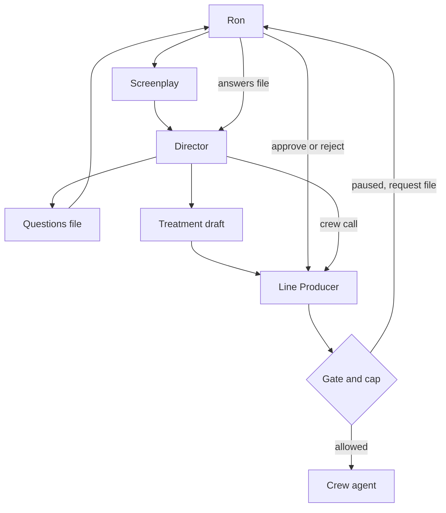

# Architecture

## What the system does

Movie Swarm takes a screenplay and works toward a finished short video. A treatment is the director's plan: intent, look, characters, scene beats, and a proposed budget split. Crew agents then do the jobs of a film crew. A handoff is the JSON file one step gives the next. A schema is the checklist that file must match. If a required field is missing, the handoff stops and the message names the file and the field.

Ron is the executive producer. He reviews at the gates. A gate is an on/off switch for one stage. While the switch is on, that stage waits for Ron. The Line Producer records his yes or no. The Director has the creative calls, and cannot approve itself.

Film facts stay in the production folder. The studio code, the agent instructions, the schemas, and the defaults do not name a film's props, years, or look. The Prop Master and the Script Supervisor read whatever hero props and locked attributes a production defines. The Cinematographer builds a camera package from that production's look file, or from the treatment when no lenses were named. Harbor Night, a tiny fixture under `tests/fixtures/`, uses a scarf and a documentary look. The same code runs it. This rule is D30.

## Where it runs

The crew is Python in this repo. You run a command on your machine. It reads and writes files in the production folder.

The Director and the Line Producer will be fronted by Grok Bot agents. Those bots live outside this repo. They show Ron the gates and the Director's questions in chat. The chat does not type into a waiting terminal. The bot reads and writes the same files these commands use, so a run can stop and start again.

Generation runs on provider servers, not on the laptop that holds the repo. Video, stills, and audio can run at the same time once a later phase turns that on. This phase does not send a paid generation. A dry run is a practice pass: the call is checked, and no generation money is spent. A cost estimate only prices the work.

## Repository

| Folder | What it holds |
|---|---|
| `agents/00-director/` | The Director's notes and command. |
| `agents/01-line-producer/` | The Line Producer's notes and command. This folder used to be the executive producer agent. Ron is the executive producer now. |
| `agents/02-screenwriter/` through `03-art-director/` | Written instructions. No program yet. |
| `agents/04-cinematographer/` | Camera package and storyboard. The program is in `movie_swarm/`. |
| `agents/05-production/` through `09-fix-loop/` | Coded crew: video, sound, edit, QA, and the fix loop. |
| `agents/10-script-supervisor/`, `11-prop-master/`, `12-stunt-coordinator/` | Phase 2 roles. The programs are in `movie_swarm/`. |
| `movie_swarm/` | Shared code: checklists, the run record, gates, money, the Director, the Line Producer, and the phase 2 package. |
| `config/` | Gates, the $500 cap, model names, and the asset root. |
| `schemas/` | The checklists. |
| `productions/the-last-marker/` | The test film. |
| `scripts/` | Commands you run from the repo root. |
| `tests/` | The shared checks. |
| `docs/` | Supporting notes, including the treatment guide. The living docs are the root files named in [CONTRIBUTING.md](CONTRIBUTING.md). |

## Main concepts and data model

**Handoff files.** Agents pass work as JSON. `movie_swarm/handoff.py` checks a file before it is accepted. A bad file is not saved.

**Schemas.** One checklist per kind of file, in `schemas/`. The treatment checklist is `treatment.schema.json`. Questions use `director-questions.schema.json`.

**Run state.** One production run keeps `runs/<run-id>/run-state.json`. It records the stage, whether the run is waiting, the files it produced, and the dollars spent against the cap that was copied when the run opened. That file is the Phase 0 record.

**Line Producer record.** `runs/<run-id>/line-producer.json` sits beside the run state. It holds the ledger (each spend), the stage split, the credits, the schedule, and Ron's decisions. The running total in the run state is updated only when a spend is actually booked.

**Gates.** `config/gates.json` has one switch per stage. `true` means Ron reviews it. A stage with no switch is an error, so a typo cannot skip a review.

**Budget cap.** The film cap is $500 in `config/gates.json`. Landing on $500 is allowed. Going over pauses the spend and writes an approval request. Retakes use the same cap. After Ron approves the treatment, each stage also has its own ceiling. A retake spends from that stage's ceiling and from the film cap.

**Model routing.** `config/model-routing.json` names the model for each role. The Line Producer and the question list use Claude Haiku 5.5. The Director's draft uses Claude Sonnet 5.5. The final treatment pass uses Claude Opus 5.5. The programs for video, sound, and QA still call the models they call today. The approved direction for later switches is decision D6.

**Asset root.** Finished video can live on an external drive. Set `MOVIE_SWARM_ASSET_ROOT`, or set `asset_root` in `config/assets.json`. Until one of those is set, files stay in the production folder. Nothing is moved by itself.

## Decisions

The choices already made are in [DECISIONS.md](DECISIONS.md). Short form:

- Ron is the executive producer. The old agent slot is the Line Producer (D1).
- The Director may call crew, inside the money Ron approved (D2, D5).
- Every stage starts gated (D3).
- The output is a finished video (D4).
- The cap is $500, retakes included (D5).
- Models are chosen to keep cost down (D6).
- The Last Marker is the test film through every phase (D7), set in 1967, with a 1965 Triumph (D10) and a Leone look (D8).
- Finished media is meant for Ron's external drive (D9). The copy step is not built yet.
- Hero props get locked specs (D11). This film's sidedness is in its production files (D27). The checker reads those files. It does not hard-code them (D30).
- A Stunt and Action Coordinator breaks the treatment's beats into shots (D12).
- The Director reaches a treatment by asking Ron questions (D13). The Last Marker treatment gate is approved and the $500 split is locked (D29).
- Docs and code land in the same pull request (D14).
- Film facts stay in the production folder (D30).

## Interfaces

Two commands. Both take a production folder and a run id. Neither waits for you to type at a prompt.

| Command | What Ron uses it for |
|---|---|
| `scripts/line-producer.py` | Start a run, read status, record a spend, approve or reject a gate, decide a spend request, add a credit. |
| `scripts/director.py` | Draft a treatment, apply an answers file, call a crew agent. |

Question file: `productions/<id>/treatment/questions.json`. Each question has an `id`, a `topic`, the question, and `answer`. Ron fills `answer`, or sends a separate file shaped as `{ "answers": [ { "id", "answer" } ] }`.

Gate file, if you prefer a file to flags:

```json
{ "stage": "treatment", "decision": "approved", "by": "ron", "note": "Lock it." }
```

A spend that would break a ceiling writes `runs/<run-id>/requests/req-001.json`. Approve or reject it with `decide`. Approving a real spend books the money, even if it is past the cap. That overage stays visible in the status. Approving a dry-run hold does not book money. It allows that one checked call.

Crew the Director can call: `prop-master`, `script-supervisor`, `cinematographer`, `stunt-coordinator`, `production`, `sound-designer`, `editor`, `qa`, `fix-loop`.

Phase 2 commands are `lock`, `check`, `package`, `boards`, and `breakdown`. They read the approved treatment. They write files. They do not require the previs gate to be open already, because those files are what Ron reviews. The estimate is checked against an existing ceiling in the locked split and is not charged.

Picture commands are `estimate` and `dry-run`. A picture call waits until Ron has approved the treatment, the previs gate, and that stage. Editor, QA, and the fix loop are routed and named. Their commands are not run here, because they would read or write the cut.

## Line Producer

Inputs: the gate file, the run state, and Ron's decision (flags or a JSON file).

Outputs: an updated run state, `line-producer.json`, a plain-language status, and an approval-request file when something must wait.

Hands off to: Ron, by the status and the request file. The Director reads the same run when it wants to call crew. The Line Producer does not write the story.

## Director

Inputs: a screenplay (Markdown, Fountain, PDF, or Word), an optional partial treatment, the production brief, and the Screenwriter and Art Director skill files as context.

Outputs: `treatment/treatment.json` (must match the checklist), `treatment/treatment.md` (the same plan in sentences), and `treatment/questions.json`. Status stays `draft`.

Hands off to: Ron, for answers and for the treatment gate. Hands off to the Line Producer before any crew call. Does not hand an approval to itself.

## Prop Master

Inputs: `props/prop-definitions.json` when the production has one, otherwise the hero props on the approved treatment and the brief.

Outputs: `props/hero-props.json`, checked against `hero-props.schema.json`, and a short Markdown note.

Hands off to: the Script Supervisor and the Cinematographer, through that locked file. Does not invent a prop or a side.

## Script Supervisor

Inputs: the locked hero props, the treatment scenes, `storyboard/shot-list.json` when it exists, and `shot-lists/shot-list.json` when it exists.

Outputs: `continuity/continuity-check.json`. A finding is a contradiction (a forbidden phrase) or a missing lock (a shot shows the prop and never states a required phrase). The phrases come from the prop file.

Hands off to: Ron, at the previs gate. This is not the QA report. QA reads a cut, later.

## Cinematographer

Inputs: `look/look.json` when the production has one, otherwise the treatment's camera and color notes and the brief.

Outputs: `camera/camera-package.json` (lenses, framing, lighting), `storyboard/storyboard.json` (board prompts and an animatic), and `storyboard/shot-list.json`. Image generation runs only when a caller passes an image client. The default path stores the prompt and does not make a picture.

Hands off to: production, through the shot list, after Ron approves the previs gate.

## Stunt and Action Coordinator

Inputs: `action_and_stunt_beats` on the approved treatment.

Outputs: `stunts/action-breakdown.json`. Each beat becomes shots. A beat that is not physically possible is marked. The safety line is the same for every film: one movement per shot, no real impact, no real fall, no real fire.

Hands off to: the Cinematographer and production, through that breakdown. Does not add a beat the treatment does not name.

## Production

Inputs: a shot list JSON.

Outputs: clip files, clip metadata, and a cost report, when a real run is allowed. This phase only runs the local price estimate, or a dry run that builds the request and does not call the video service.

Hands off to: the editor and QA, through the clip metadata, once a later phase generates real clips. Today the handoff stops at the Line Producer's check.

## Sound Designer

Inputs: a shot list, and an output folder.

Outputs: audio files and an audio manifest, when a real run is allowed. The dry run writes a manifest of what it would make, and does not call the audio service.

Hands off to: the editor, through the audio manifest.

## Editor

Inputs: the selected clips and, when used, a mix file.

Outputs: a rough cut and an edit decision list. Probe and assemble are not run by the Director in this phase.

Hands off to: QA, through the cut.

## QA

Inputs: a cut, plus the style bible and the shot list.

Outputs: a continuity report and a short summary. The review calls a model and is not run by the Director in this phase. Frame extraction needs the cut on disk.

Hands off to: the fix loop, through the report.

## Fix Loop

Inputs: the latest QA report and the shot list.

Outputs: a fix plan with changed prompts. Showing or writing that plan is not run by the Director in this phase, so a dispatch cannot overwrite the pilot's fix notes.

Hands off to: production, the editor, and QA, for another pass. The cap still applies. A retake is not free.

## Flow



## Not in this phase

- A full orchestrator that runs every future role by itself.
- Coverage, extra takes, a Dailies Reviewer, or an Assistant Editor.
- Color, a composer, Foley, a mixer, or a test audience.
- QA on the full finished cut, or a Post Supervisor in place of the fix loop.
- Real video or audio generation. No generation money is spent. Storyboard images stay behind an image client. The default client is none.
- Copying finished files to the external drive at the end of a run. The setting exists. The copy does not.
- Switching the video program to Gemini Omni 1.2 Flash, or QA to Gemini. That direction is decided. The programs still call what they call today.
- Moving the pilot sound library out of `agents/06-sound-designer/src/pipeline.py`. It still names this film. D30 says that list belongs in the production folder. That move is open.
